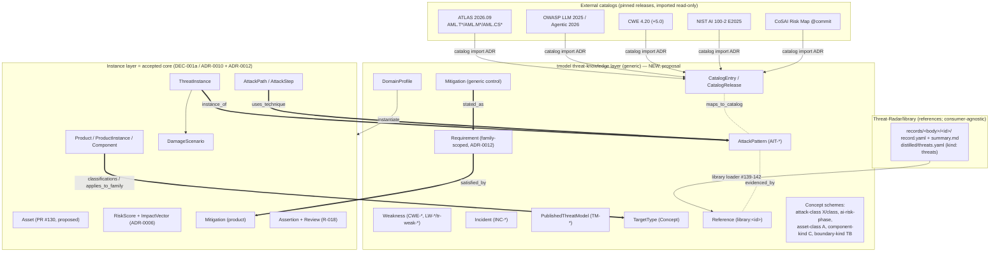
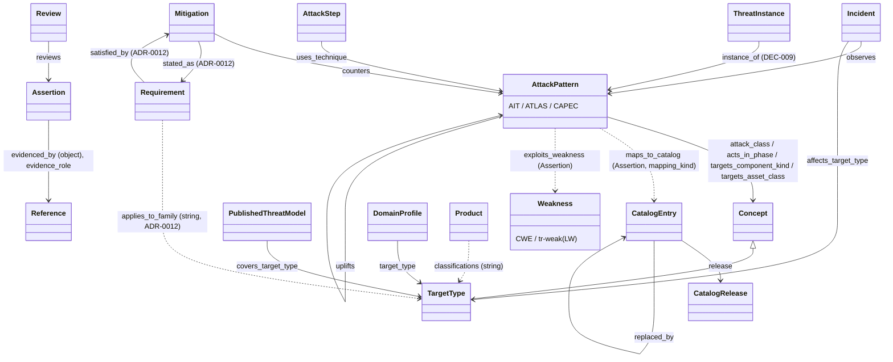
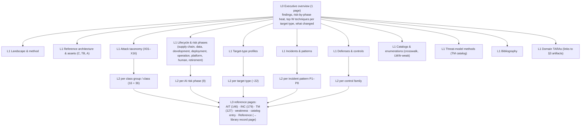
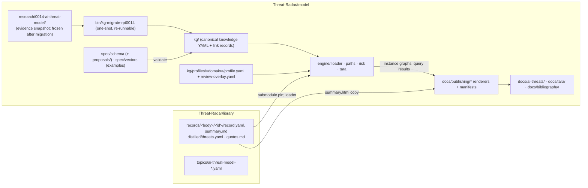

# Thread C — Representation design memo: AI threat knowledge, domain profiles, reproducible TARA, hierarchical report

**Status:** planning memo (thread C of the RPT-0014 / #71 planning effort). **Read-only input; accepts no `DEC-*`.**
Every schema element below is a *proposal* that routes to an ADR (ARCH-0001 §9). Where an accepted ADR
already covers a choice, the memo says so and builds on it; where it does not, it flags the ADR/DEC needed.

**Inputs read (tmodel `main` @ 449f515 + open PRs #130, #167; library `main` @ 6d9a51f):**
ARCH-0001 v0.1.8; ADR-0004/0006/0007/0008/0010; PR #167 (ADR-0012 Requirement in core); PR #130
(Asset/TrustBoundary/DataFlow/ComponentKind proposal, DL-0024); `spec/schema/tmodel-object-model.linkml.yaml`
+ `OBJECT-MODEL.md`; `spec/vectors/` (mvp-02, tv-software-auth-service); RPT-0007 §2/§5; RPT-0013 SDL
object model; MAP-0001; RPT-0015 §3–5; RPT-0016 §1.7/§3; RPT-0006 §8; RPT-0014 (report v0.2.0,
attack-catalog.yaml, sources.md, incidents.md, threat-models.md, enumerations.md, LANES.md); engine
`paths.py` (#63 Part 1); PLAN-0002 §5 (CWE import, `tr-weak-*`); PLAN-0003; `docs/publishing/*`;
library `schema/record.schema.yaml` v0.8.0, `artifact.schema.yaml` (incl. `threats` family),
`requirements.linkml.yaml` v3.1, `topic.schema.yaml`, `tags.yaml`.

---

## 0. Summary of the design (one screen)

1. **Two layers, one graph.** A *threat-knowledge layer* (generic, reusable: techniques, classes, weaknesses,
   catalog entries, incidents, published threat models, generic controls, target types, domain profiles,
   references) and the accepted *instance layer* (a product's threat model: Product/Component/Asset,
   ThreatInstance, AttackStep/Path, DamageScenario, RiskScore, Mitigation). They are joined only by
   **typed, reviewable bridge edges** (`instance_of`, `uses_technique`, `exploits_weakness`, `stated_as`,
   `applies_to_family`) — the DEC-009 seam.
2. **Reuse the accepted core wherever it fits.** An AIT technique *is* an `AttackPattern`; a CWE or `LW-*`
   *is* a `Weakness`; a generic control *is* a `Mitigation` that is `stated_as` a family-scoped
   `Requirement` (ADR-0012 pattern). New classes are only those the core has no home for: `Concept`
   (taxonomies), `CatalogRelease`/`CatalogEntry`, `Incident`, `PublishedThreatModel`, `Reference`,
   `TargetType`, `DomainProfile`.
3. **Every bibliography link is a link record, never a foreign key.** `Reference` nodes (one per
   library record, generated by the library loader) are joined to any knowledge or instance node by a
   reified `Assertion` with predicate `evidenced_by` and qualifiers (`evidence_role` ∈ supports /
   describes / demonstrates / mitigates / contradicts / catalogs / measures, `locator`, `quote_sha256`)
   plus provenance and Review — exactly ADR-0004's "explicit link records" and the R-018 spine.
4. **Target types are a concept scheme; domain profiles are versioned templates** that instantiate a
   TARA: reference-architecture template (C01–C21 kinds, TB1–TB14), asset templates (A01–A18),
   technique-selection rules, attack-path templates, *feasibility/impact priors (labelled as priors,
   never as ratings)*, and generic mitigations → family requirements.
5. **Reproducible TARA = lockfile + deterministic pipeline + static HTML.** `profile@ver + KB commit +
   catalog releases (sha256) + library pin + review overlay + tool versions` → `tara-lock.yaml` → the
   seven ISO/SAE 21434 clause-15 steps (engine #63 for paths and M(I,F)) → canonical instance graph →
   static, script-free HTML + exports + `provenance.json`. A rerun on the same lock is byte-identical;
   a rerun on a new lock produces a semantic diff with root-cause attribution.
6. **Hierarchical report** L0 → L1 parts → L2 mini-reports (per class / phase / target type) → L3
   reference pages (per AIT, INC, TM, LW, catalog entry, library record). L2/L3 are *generated from
   the KG + library* around *human-written prose fragments* whose numbers are placeholders filled from
   data (no stale counts). Bibliography renders as a many-to-many hierarchy (class / target / phase /
   source type / year), every entry with summary + categorization chips + artifact links + review state.
7. **New decisions needed:** a threat-knowledge-layer ADR (amends DEC-001a), a catalog-layer interchange
   ADR (amends ADR-0007), DEC-008 (catalog versioning, `LW-*` vs `tr-weak-*`), DEC-009 (target type /
   product family, bridge edges, treatment), DEC-001b fixes (C1 Review range, C2 digest — this memo
   proposes a concrete canonicalization), a DEC-003 follow-up (priors, maturity as display-only).

---

## 1. KG model for AI threat knowledge

### 1.1 Layering and where it attaches to the accepted object model



Rules that keep this consistent with the accepted ADRs:

| rule | grounded in |
|---|---|
| Every node keeps one stable `id` across YAML, Oxigraph/RDF-star, GraphML; knowledge-layer ids are namespaced CURIEs (`ait:AIT-064`, `inc:INC-162`, `tm:TM-058`, `weakness:cwe-1427`, `weakness:tr-weak-0004`, `catalog:atlas@2026.09:AML.T0051.001`, `ref:greshake-2023-indirect-prompt-injection`, `tt:enterprise-llm-agent`, `dp:enterprise-llm-agent`). | ADR-0004 (ID stability), AGENTS rule "same id means the same thing everywhere" |
| Knowledge-layer YAML is canonical in git; Oxigraph is a rebuildable cache; Turtle/JSON-LD/GraphML/CSV are derived. | ADR-0004, ADR-0008 |
| The schema is LinkML; JSON-Schema/SHACL generated; cross-instance rules in the Python integrity checker. | ADR-0007, RPT-0015 §4 |
| Anything AI-produced (all 146 AIT entries, all S-id summaries, all mappings, all maturity ratings) enters as a `proposed` Assertion or carries `epistemic_status: ai-proposed`; never rendered as reviewed. | ARCH-0001 §2/§7, R-018, ADR-0010 |
| Generic → product binding is an edge, never a copy. The instance layer *references* AIT; it does not restate it. | ARCH-0001 §7 (R-020), DEC-009 (open) |
| tmodel references library records by opaque `library:<id>` only; the library never depends on tmodel. | ADR-0012 (`source_ref`), library `artifact.schema.yaml` `threats.consumed_by`, PLAN-0003 D1/D3 |

### 1.2 Class-by-class design

**AttackTechnique (AIT) → accepted `AttackPattern`, extended.** The accepted class is "generic attack
pattern (CAPEC / ATT&CK technique = *what*)" with only `catalog_ref`. AIT entries are exactly that,
so **no new class**; add knowledge-layer slots (proposal) via a mixin `ThreatKnowledgeEntry`:

| slot | range | from attack-catalog.yaml | note |
|---|---|---|---|
| `slug` | string | `slug` | human key; id stays `ait:AIT-NNN` |
| `attack_class` | → Concept (scheme `attack-class`) | `class` (36 values) | fine class; its `broader` is the X-group |
| `intent` | enum `ThreatIntent` {adversarial, accidental, insider-accidental, provider, autonomous-agent, accidental-or-misuse} | `intent` | RPT-0016 SR-I3; distinct from `method_facet` |
| `acts_in_phase` | → Concept (scheme `ai-risk-phase`) * | `lifecycle_stage` | see §1.3; maps to core `LifecyclePhase` |
| `attacker_access`, `attacker_knowledge` | enum `AttackerAccess`, `AttackerKnowledge` {white-box, grey-box, black-box, none} | same | normalise today's free text (RPT-0015 "free strings must be enums") |
| `preconditions` | string * | same | later: structured `Precondition` (quantity, write path) — post-MVP |
| `targets_component_kind` | → Concept (scheme `component-kind`, C01–C21) * | `reference_components` | the key for target-type applicability |
| `targets_asset_class` | → Concept (scheme `asset-class`, A01–A18) * | `asset_classes` | |
| `compromises_property` | enum `SecurityProperty` * | `impacts` | reuse PR #130's `SecurityProperty` if accepted |
| `maturity` | enum `ThreatMaturity` {exploited-in-wild, occurred-in-wild, demonstrated-production, demonstrated-research, theoretical} | `maturity` | **derived**, never authored: recomputed from `observed_in` incidents' kinds by the generator; checker fails on drift (RPT-0016 SR-I10). Display-only w.r.t. risk until DEC-003 says otherwise |
| `uplifts` | → AttackPattern * | (new) | AI-enabled offense (X14): AIT-126 *uplifts* ATT&CK T1566 — answers RPT-0014 Q1 "both" |
| `epistemic_status` | enum (§1.5) | `review_status: hypothesis` | |

Edges that today are lists inside each AIT record become **link records** (Assertions), because each
needs provenance and review:

| today (`attack-catalog.yaml`) | becomes | predicate |
|---|---|---|
| `catalog_ids.atlas/owasp_llm/owasp_agentic/cwe/nist_ai_100_2/other` | AIT → CatalogEntry or Weakness, qualifier `mapping_kind` (SKOS exact/close/broad/narrow/related) | `maps_to_catalog`, `exploits_weakness` |
| `example_incidents` | Incident → AIT | `observed_in` (inverse `observes`) |
| `mitigations` (free text with AML.M ids) | generic Mitigation → AIT; Mitigation → CatalogEntry(AML.M*) | `counters` (generic) / `maps_to_catalog` |
| `sources` (S-ids) | AIT → Reference | `evidenced_by` + `evidence_role` |
| `maturity_basis` | derived; not stored | — |

**AttackClass → `Concept` in scheme `attack-class`.** Two levels: 16 class groups X01–X16 (report §4)
→ 36 fine classes (catalog `class`). Hierarchical via `broader`; each X-group also maps to the report
§3.1–3.15 sections (`report_section` annotation) so the L2 mini-report for a class has a stable anchor.
A single generic `Concept` class (SKOS-shaped: `scheme`, `notation`, `pref_label`, `definition`,
`broader`, `exact_match`) serves all taxonomies — attack class, AI risk phase, asset class, component
kind, trust-boundary kind, target type — instead of six near-identical classes. It exports cleanly to
JSON-LD/Turtle as `skos:Concept` (ADR-0007 export set).

**Weakness (CWE + LW-*) → accepted `Weakness`.** CWE entries are imported per PLAN-0002 §5 (full fields,
per-view relationships, #144–146). RPT-0014's 16 candidate local weaknesses `LW-001…016` are the same
kind of object as PLAN-0002's `tr-weak-*` ("home for domain-specific or AI-proposed weakness types").
**Conflict to resolve (DEC-008):** two local namespaces for one concept. Recommendation: one namespace,
`weakness:tr-weak-NNNN` with `source: local`, `aliases: [LW-004]`, `status: candidate`,
`candidate_parent: [weakness:cwe-345, …]`, `superseded_by` → a future CWE 5.0 id, `wg_submission`
(e.g. CDR #174 for LW-005). Keep `LW-*` as a permanent alias so RPT-0014 text stays valid.

**CatalogEntry + CatalogRelease (new, knowledge layer).** RPT-0014 shows ids drift (ATLAS deprecations
AML.T0019 → AML.T0115.000; 9 of 10 OWASP LLM ids changed meaning between 2023 and 2025). So:

- `Catalog` (framework: `atlas`, `owasp-llm`, `owasp-agentic`, `owasp-ml`, `cwe`, `capec`, `nist-ai-100-2`,
  `cosai-risk-map`, `maestro`, `owasp-mcp`, `attack`, `d3fend`) — one node each.
- `CatalogRelease` — `catalog`, `release` (`2026.09`, `2025`, `4.20`, `E2025`, commit `0d8bfc9b5d76`),
  `released` date, `source_ref` → `library:<record>` that holds the bytes, `content_sha256` of the
  imported bundle, `data_format` (ATLAS `6.0.0`).
- `CatalogEntry` — `release` → CatalogRelease, `local_id` (`AML.T0051.001`, `LLM01`), `entry_kind`
  {technique, sub-technique, tactic, mitigation, case-study, risk-category, weakness, taxonomy-node},
  `label`, `external_maturity` (ATLAS Feasible/Demonstrated/Realized), `deprecated`, `replaced_by`
  (→ CatalogEntry, the alias table), `same_as_previous` (→ CatalogEntry in an older release, e.g.
  `LLM01:2023` vs `LLM01:2025` *not* same).
- Canonical string form for any versioned external id (fixes SR-I1 without breaking the accepted
  `catalog_ref: string`): **`<framework>@<release>:<local_id>`**, e.g. `atlas@2026.09:AML.T0051.001`,
  `owasp-llm@2025:LLM01`, `cwe@4.20:CWE-1427`. An unversioned `catalog_ref` (as in today's vectors,
  `CWE-306`) resolves against the KB lock's default release and is flagged `ambiguous` by the checker.
- Where the external entry *is* a core type, the import may also materialise the core node with a
  `catalog_entry` back-pointer: CWE → `Weakness` (PLAN-0002 already does), CAPEC/ATT&CK/ATLAS technique
  → `AttackPattern`, ATLAS `AML.M*`/D3FEND → `Mitigation`, ATLAS `AML.CS*` → `Incident`. OWASP Top-10
  items and NISTAML taxonomy nodes stay `CatalogEntry` only (they are risk categories, not patterns).
  **Local AIT never merges with an ATLAS technique**; it `maps_to_catalog` it with a `mapping_kind`,
  because RPT-0014 says every catalog id there is "a candidate edge, not an asserted mapping".

**Incident (new).** From incidents.md (179):
`date` (+ `date_precision`), `incident_kind` enum {ITW, ITW-Q, DV, RD, ACC, TI, LEG} (+ `qualifier`
for ITW-Q), `target_description`, `affects_target_type` → TargetType *, `observes` → AttackPattern *,
`involves_vulnerability` → Vulnerability * (CVE when one exists; non-CVE ids allowed per SR-I2),
`atlas_case_study` → CatalogEntry, `impact` → SecurityProperty/impact category *, `primary_source` →
Reference (plus `evidenced_by` links for the "Also" sources). Patterns P1–P8 become `Concept`s in
scheme `incident-pattern` (L2 mini-reports).

**PublishedThreatModel (new; name chosen to avoid collision with DEC-001b `ThreatModel`).** From
threat-models.md (127) and its comparison table: `source` → Reference, `scope` (ML / GenAI / agentic /
asset-specific / sector), `primary_axis`, `decomposition`, `asset_model` {explicit, implicit, none},
`attacker_model`, `stable_threat_ids` (bool), `mitigations_linked` {yes, partial, no},
`machine_readable` {format string | none}, `validation`, `method_facet` → extends `MethodFacet`
(maestro, linddun, stride, owasp-agentic, cosai, ...), `covers_target_type` → TargetType *,
`covers_technique` → AttackPattern * (as Assertions), `import_candidate` (OTM/STIX/none),
`capture_status` (from the #73 extraction). A PublishedThreatModel is *knowledge about a method*; a
domain profile may `adopts_method` it (e.g. MAESTRO layers for the agent profile).

**Mitigation / Control.** Two roles, one class (accepted `Mitigation`):

- *Generic control* (knowledge layer): `counters` → AttackPattern | Weakness * (Assertion-backed),
  `catalog_ref` (AML.M*, D3FEND, CoSAI control), plus proposed assurance slots from RPT-0016 SR-I8:
  `control_layer` {model-internal, system-deterministic, process, detective}, `evaluated_against_adaptive`
  (bool), `guarantee_scope` (string), `utility_cost` (string). It is `stated_as` a family-scoped
  `Requirement` (`applies_to_family: tt:…`, `requirement_kind`, `addresses` → AIT/Weakness) — **this
  is exactly ADR-0012's generic-mitigation → requirement → product-mitigation chain**, so no new edge
  is needed beyond `counters`.
- *Product mitigation* (instance layer): unchanged — `mitigates` → ThreatInstance, `mitigation_status`,
  `implementation_owner`, `satisfies` via `Requirement.satisfied_by`.

**LifecyclePhase.** The accepted `LifecyclePhase`/`LifecyclePhaseCode` (concept … decommission,
21434/26262-aligned) is the *product* lifecycle and must not be overloaded. The AI risk phases the
sponsor asked for are a **`Concept` scheme `ai-risk-phase`** whose members map to one or more
`LifecyclePhaseCode`s (§1.3). `ThreatInstance.applies_in_phase` (accepted) keeps pointing at
`LifecyclePhase`; the knowledge layer's `acts_in_phase` points at the AI-phase concept; the profile
instantiation resolves one to the other.

**Reference (new, thin).** One node per library record the KG cites: `id: ref:<library-record-id>`,
`library_ref: library:<id>` (opaque), `library_pin` (submodule commit the facts were read at),
`record_status` (stub…distilled), `source_type` (paper, vendor-research, survey, threat-model,
framework, catalog, advisory, dataset, standard, news, tool — sources.md's 11 types), `year`,
`confidence` (incl. `medium-capped`), `has_summary` (bool), `legacy_ids: [S-0166]`. **Generated by the
library loader (#139–142), never hand-authored**, so title/authors/summary are never duplicated into
tmodel. S-ids are mapped once (`research/0014-ai-threat-model/source-ids.yaml`: `S-0003 →
szegedy-2013-intriguing-properties`, the canonical slug sources.md already carries) and kept as aliases.

**Typed evidence edges (the many-to-many the sponsor asked for).** Not a new class: an
`Assertion` with `predicate: evidenced_by`, `subject` = any knowledge or instance node (AIT, Weakness,
Incident, PublishedThreatModel, TargetType, Mitigation, DomainProfile, ThreatInstance, even a
RiskScore), `object` = Reference, and qualifiers:

| qualifier | values / meaning |
|---|---|
| `evidence_role` | `supports` (argues the claim), `describes` (defines/explains it), `demonstrates` (shows it working: PoC, red team, CVE), `observes` (reports it in the wild), `mitigates` (proposes/evaluates a defense), `contradicts` (refutes or fails to reproduce), `catalogs` (assigns an id in a taxonomy), `measures` (gives numbers: ASR, cost, prevalence) |
| `locator` | section/page/figure in the source (FX-1 convention) |
| `quote_sha256` | digest of the exact span (quote-grounding, RPT-0015 §5); the quote itself lives in the library record's `quotes.md`, licence permitting |
| `confidence` | low/medium/high (+ `medium-capped` per sources.md rule C15) |

Provenance + review on the Assertion (needs PR #130 Part A's `asserted_by`, `asserted_at`,
`generated_by`, `evidence` slots, or equivalent): `generated_by` = an Activity string
`agent:<model>@<version>#prompt:<sha256>` for AI-proposed links, `asserted_by` = Party for human-authored.
Bulk migration of the 769 AIT→S-id pairs yields `evidence_role: describes`, `assertion_status:
proposed`; reviewers refine the role when they accept.

### 1.3 AI risk-phase scheme (supply chain and development included)

| AI risk phase (`ai-risk-phase`) | catalog `lifecycle_stage` values folded in | maps to `LifecyclePhaseCode` | report anchor |
|---|---|---|---|
| `aip:supply-chain` — sourcing models, data, packages, tools, MCP servers, skills | supply-chain; parts of model-artifact | design, implementation, production, distribution | §3.3, TB3 |
| `aip:data` — collection, crawl, labelling, preference data, RAG corpora | data | design, implementation, operation (RAG refresh) | TB1, TB2 |
| `aip:development` — training, fine-tuning, evaluation, model transformation, model artifact | training; model-artifact | implementation, verification_validation | §3.2, §3.3, TB4 |
| `aip:deployment` — packaging, registry→serving, configuration, provider onboarding, identities | deployment | production, distribution, deployment | TB4, TB5, TB8 |
| `aip:operation-inference` — model I/O, RAG retrieval, guardrails | inference | operation, maintenance | §3.1, §3.8–3.10 |
| `aip:operation-agentic` — tool use, memory, delegation, multi-agent, approvals | agent-runtime | operation | §3.11, §3.12, TB7–TB9, TB13, TB14 |
| `aip:platform` — AI infrastructure, MLOps control plane, shared hardware | infrastructure | operation, maintenance (and implementation for build infra) | §3.6, §3.7, TB12 |
| `aip:human-org` — AI-enabled offense against people, shadow AI, AI-tool lures | human | operation (organisation-wide) | §3.14 |
| `aip:retirement` — model retirement/upstream change, unlearning, decommission | (AIT-137, AIT-142) | end_of_support, decommission | §3.15 |

The mapping is many-to-many and lives in the scheme file (`exact_match`/`related_match` to
`LifecyclePhaseCode`), so the L2 "phase" mini-reports and the SDL phase line (MAP-0001 canonical phase
line: requirements → design → implementation → verification → release → response) can both be produced.

### 1.4 Target-type taxonomy (proposal)

Target types answer "what kind of product/system is being modelled". They are **`Concept`s in scheme
`target-type`** (hierarchical), carried on products via the **existing** `Product.classifications`
string (ADR-0012 design choice 1: `applies_to_family` matched against `Product.classifications`), so no
`ProductFamily` class is created before DEC-009. Each leaf carries a `reference_architecture`
(component kinds + boundaries), `typical_assets`, an AWS GenAI Scoping Matrix `ownership_scope`
(TM-126; scope 1 consumer app … 5 self-trained model — what the owner controls, hence which techniques
can only be accepted/transferred, TB5), and the ADR-0002 instance type (software / hardware / system).

| id | target type | component kinds (C-ids) | key assets (A-ids) | scope | ADR-0002 type |
|---|---|---|---|---|---|
| **tt:ai-application** | *AI-enabled applications* | | | | |
| tt:enterprise-copilot-rag | Enterprise assistant / copilot over enterprise data | C01 C06 C07 C11 C12 C13 C17 C18 C19 | A04 A05 A07 A09 A13 | 2–3 | software |
| tt:enterprise-llm-agent | Enterprise LLM agent (tools, MCP, delegated credentials) | + C08 C09 C10 C11 (TB7–TB9, TB13, TB14) | A06 A07 A09 A10 A14 | 2–4 | software |
| tt:coding-assistant | Coding assistant / coding agent (IDE, CLI, CI) | C07 C08 C09 C11 C13 C14 C17 | A08 A09 A10 | 2–3 | software |
| tt:browser-computer-use-agent | Browser / computer-use agent, AI browser | C08 C11 C17 C20 | A07 A09 A14 | 2–3 | software |
| tt:customer-chatbot | Customer-facing chatbot | C06 C07 C12 C13 | A04 A07 A13 A17 | 2–3 | software |
| tt:multi-agent-system | Multi-agent / agent-protocol system (A2A) | C08 C09 C10 C11 | A06 A09 A12 | 3–4 | system |
| tt:agentic-commerce | Payment / transaction agent | C08 C11 C21 C12 | A14 A09 | 3 | system |
| tt:ai-security-tooling | AI-driven security tooling, LLM-as-judge, guard models | C05 C07 C17 | A16 A12 | 3–5 | software |
| **tt:ml-producer** | *Model producers and ML platforms* | | | | |
| tt:foundation-model-developer | Foundation-model developer (pretraining) | C01 C02 C03 C04 C05 C15 | A01 A02 A03 | 5 | system |
| tt:model-customization | Fine-tuning / model-customisation service | C02 C03 C04 C13 | A01 A02 A03 | 4 | software |
| tt:ml-platform | ML platform / MLOps (training + registry + serving) | C02 C03 C04 C05 C14 C15 | A02 A08 A09 A10 A11 | 4–5 | system |
| tt:model-hub-registry | Model hub / artifact registry | C04 C14 | A02 A08 A13 | — | software |
| tt:inference-provider | Hosted model API / inference provider, AI gateway | C05 C13 C15 C18 | A02 A07 A11 | 1 (as seen by customer) | system |
| **tt:predictive-perception** | *Predictive and perception ML* | | | | |
| tt:automotive-perception | Automotive perception (camera/LiDAR/radar ADAS) | C03 C05 C16 C17 (TB11) | A03 A12 A17 | 5 | hardware + system (21434-native) |
| tt:biometric-kyc | Biometric / KYC identity verification | C05 C07 C16 C12 | A12 A14 A15 A18 | 3–5 | software (+ device) |
| tt:security-classifier | Fraud / malware / spam / content-moderation classifier | C02 C03 C05 C17 | A12 A16 A13 | 5 | software |
| **tt:edge-embodied** | *Edge and embodied AI* | | | | |
| tt:on-device-model | On-device / mobile model | C05 C16 | A02 A07 | 4–5 | hardware |
| tt:robotics-embodied-agent | Robot / embodied agent | C08 C16 C17 | A12 A17 | 4–5 | system |
| tt:voice-assistant | Voice assistant | C05 C07 C16 | A07 A15 | 2–4 | hardware + software |
| **tt:generative-media** | *Generative media and provenance* | | | | |
| tt:media-generation-service | Text-to-image/video service, watermarking | C03 C05 C07 | A03 A13 A18 | 5 | software |
| **tt:organisation** | *The organisation itself (target need not use AI)* | | | | |
| tt:enterprise-workforce | Workforce and business processes facing AI-enabled offense, shadow AI | C12 C13 C14 | A07 A09 A13 A14 A15 | — | system |

Mapping to the object model: a target type's reference architecture is a set of **component-kind
concepts** (C01–C21) that instantiate as `Component`s typed by `component_kind` (PR #130 proposes
`Component.component_kind`; recommend its range be the `component-kind` concept scheme rather than a
closed enum, so the 21 AI kinds and the existing software/hardware kinds coexist), and **asset-class
concepts** (A01–A18) that instantiate as `Asset`s (PR #130 Part B) with an owner-set impact. Trust
boundaries TB1–TB14 instantiate as PR #130 `TrustBoundary` zones typed by a `boundary-kind` concept.
Until PR #130 is accepted, profiles can still be instantiated against the core: assets become
`DamageScenario` descriptions + `owned_by` on Components (as mvp-02 does), which is lossy and flagged.

Applicability of a technique to a target type has **three sources, kept distinct** so a reader can see
why a technique is in a TARA:

1. *derived*: `targets_component_kind ∩ profile components ≠ ∅` and `acts_in_phase` ∈ profile scope
   (computed; not stored);
2. *curated*: Assertion `applies_to_target_type` (AIT → TargetType) with rationale, reviewed;
3. *evidenced*: an Incident `observes` the AIT and `affects_target_type` the type (raises display
   maturity for that type: "W for coding assistants" ≠ "W overall").

Exclusions are explicit Assertions too (`not_applicable_to_target_type` + reason) so a TARA shows
"considered and excluded", which 21434 RQ-15-03 reviewers expect.

### 1.5 Provenance and review state (R-018)

`Review.reviews` ranges only on `Assertion` today (DL-0020 blocker C1). For knowledge-layer *nodes*
(is AIT-064's description right? is LW-004 a real weakness?) two options:

- **(a) no schema change:** reify node acceptance as `Assertion(subject=node, predicate=is_valid_entry,
  object=<KnowledgeRelease node>)` and review that. Works today; clunky queries.
- **(b) recommended, coupled to the C1 fix:** widen `Review.reviews` to `any_of: [Assertion, Node]`
  (C1 needs Mitigation→Review anyway). Then every node and every link has the same review spine.

Display state is **derived** (never hand-set) from Assertion status + Reviews, into one enum used by
every renderer, with a text label (non-colour cue, RPT-0016 SR-U5):

| `epistemic_status` | meaning | badge text |
|---|---|---|
| `imported-authoritative` | entry imported verbatim from a pinned external catalog release; the importer is reviewed, not each entry | `IMPORTED atlas@2026.09` |
| `ai-proposed` | produced by an agent; no human review | `AI-PROPOSED — hypothesis` |
| `human-authored` | written by a person, not yet independently reviewed | `AUTHORED` |
| `reviewed-accepted` | ≥1 accepting Review (≥2 independent for TARA approval, per RPT-0013-OM `approvers[]`) | `REVIEWED` |
| `reviewed-rejected` | rejecting Review; kept, shown struck-through in TARA, hidden by default in reports | `REJECTED` |
| `disputed` | conflicting Reviews or a `contradicts` evidence link | `DISPUTED` |
| `superseded` | replaced by a newer entry/release | `SUPERSEDED → <id>` |
| `derived` | computed by the generator (maturity, coverage, risk) from reviewed-or-not inputs; inherits the weakest input state | `DERIVED (inputs: n AI-proposed)` |

### 1.6 LinkML-ish sketch (proposal module; imports the core)

```yaml
# spec/schema/proposals/tmodel-threat-knowledge.linkml.yaml  — PROPOSAL, accepts nothing.
# ADR-0010 keeps the object model "one file"; either an ADR permits modules or this folds into
# the core file on acceptance. Validated via a proposal container like PR #130's.
id: https://threat-radar.github.io/tmodel/schema/threat-knowledge
name: TmodelThreatKnowledge
imports: [linkml:types, ../tmodel-object-model]
prefixes:
  skos: http://www.w3.org/2004/02/skos/core#
  ait: https://threat-radar.github.io/tmodel/id/ait/
  library: https://w3id.org/library/records/
default_prefix: tmodel

mixins:
  ThreatKnowledgeEntry:
    mixin: true
    description: Shared knowledge-layer metadata. Never instance data.
    slots: [epistemic_status, aliases, kb_release, deprecated, superseded_by_node]

classes:
  Concept:                       # one class for every taxonomy
    is_a: Node
    class_uri: skos:Concept
    slots: [scheme, notation, pref_label, definition, broader, exact_match, related_match]
    slot_usage:
      scheme: {required: true, range: ConceptSchemeId}
  TargetType:                    # a Concept in scheme target-type, with template data
    is_a: Concept
    slots: [ownership_scope, instance_type, reference_component_kinds, reference_boundary_kinds,
            typical_asset_classes]
  Catalog:
    is_a: Node
    slots: [framework]
  CatalogRelease:
    is_a: Node
    slots: [catalog, release, released, data_format, source_ref, content_sha256]
  CatalogEntry:
    is_a: Node
    mixins: [ThreatKnowledgeEntry]
    slots: [release, local_id, entry_kind, external_maturity, replaced_by, same_as_previous]
    unique_keys: {release_local: {unique_key_slots: [release, local_id]}}
  Incident:
    is_a: Node
    mixins: [ThreatKnowledgeEntry]
    slots: [date, date_precision, incident_kind, qualifier, target_description, affects_target_type,
            observes, involves_vulnerability, atlas_case_study, compromises_property, primary_source,
            incident_pattern]
  PublishedThreatModel:
    is_a: Node
    mixins: [ThreatKnowledgeEntry]
    slots: [source, tm_scope, primary_axis, decomposition, asset_model, attacker_model,
            stable_threat_ids, mitigations_linked, machine_readable, validation, method_facet,
            covers_target_type, import_candidate, capture_status]
  Reference:                     # generated by the library loader; never hand-authored
    is_a: Node
    slots: [library_ref, library_pin, record_status, source_type, year, confidence, has_summary,
            legacy_ids]
  DomainProfile:                 # §2
    is_a: Node
    mixins: [ThreatKnowledgeEntry]
    slots: [profile_version, target_type, adopts_method, component_templates, boundary_templates,
            flow_templates, asset_templates, selection_rules, path_templates, priors,
            generic_mitigations, assumptions, out_of_scope]

  # --- extensions of ACCEPTED core classes (need an ADR amending DEC-001a) ---
  AttackPattern:                 # slot additions only; no rename/narrowing
    mixins: [ThreatKnowledgeEntry]
    slots: [slug, attack_class, intent, acts_in_phase, attacker_access, attacker_knowledge,
            preconditions, targets_component_kind, targets_asset_class, compromises_property,
            maturity, uplifts]
  Weakness:
    mixins: [ThreatKnowledgeEntry]
    slots: [weakness_source, candidate_parent, wg_submission, catalog_entry]
  Mitigation:
    slots: [counters, control_layer, evaluated_against_adaptive, guarantee_scope]
  ThreatInstance:
    slots: [instance_of, targets_element]   # targets_element from PR #130
  AttackStep:
    slots: [uses_technique, exploits_weakness]   # PR #130 gap P4 (step→weakness)
  Assertion:                     # PR #130 Part A provenance + evidence qualifiers
    slots: [asserted_by, asserted_at, generated_by, evidence_role, locator, quote_sha256,
            mapping_kind]

slots:
  maturity:
    range: ThreatMaturity
    annotations: {derived: "from observed_in Incident kinds; checker recomputes; never authored"}
  instance_of:      {range: AttackPattern, multivalued: true,
                     annotations: {reify_when_reviewed: true, decision: DEC-009}}
  uses_technique:   {range: AttackPattern, multivalued: true}
  counters:         {any_of: [{range: AttackPattern}, {range: Weakness}], multivalued: true}
  observes:         {range: AttackPattern, multivalued: true, inverse: observed_in}
  library_ref:      {range: uriorcurie, pattern: "^library:[a-z0-9][a-z0-9-]*$"}
  catalog_ref:      # accepted slot; ADD a pattern allowing the versioned form, keep bare ids legal
    pattern: "^([a-z0-9-]+@[A-Za-z0-9.]+:)?[A-Za-z0-9._:-]+$"
  # … remaining slot definitions elided

enums:
  ThreatIntent: {permissible_values: {adversarial: {}, accidental: {}, insider_accidental: {},
                 provider: {}, autonomous_agent: {}, accidental_or_misuse: {}}}
  ThreatMaturity: {permissible_values: {exploited_in_wild: {}, occurred_in_wild: {},
                   demonstrated_production: {}, demonstrated_research: {}, theoretical: {}}}
  IncidentKind: {permissible_values: {ITW: {}, ITW_Q: {}, DV: {}, RD: {}, ACC: {}, TI: {}, LEG: {}}}
  EvidenceRole: {permissible_values: {supports: {}, describes: {}, demonstrates: {}, observes: {},
                 mitigates: {}, contradicts: {}, catalogs: {}, measures: {}}}
  MappingKind:  {permissible_values: {exact: {meaning: skos:exactMatch}, close: {meaning: skos:closeMatch},
                 broad: {meaning: skos:broadMatch}, narrow: {meaning: skos:narrowMatch},
                 related: {meaning: skos:relatedMatch}}}
  EpistemicStatus: {permissible_values: {imported_authoritative: {}, ai_proposed: {}, human_authored: {},
                    reviewed_accepted: {}, reviewed_rejected: {}, disputed: {}, superseded: {}, derived: {}}}
  ControlLayer: {permissible_values: {model_internal: {}, system_deterministic: {}, process: {}, detective: {}}}
```



---

## 2. Domain profiles: reusable templates that instantiate a TARA

### 2.1 What a profile is

A `DomainProfile` is a **versioned, reviewed template** for one target type (or a composition of
several: an enterprise agent that is also a coding assistant composes two). It is generic knowledge,
not a product; instantiating it yields a *reference instance* (a synthetic product used for the
reproducible domain TARA) or a *real product's* starting model (DEC-009 seam).

```yaml
# kg/profiles/enterprise-llm-agent/profile.yaml   (proposal shape)
id: dp:enterprise-llm-agent
profile_version: 0.1.0
target_type: tt:enterprise-llm-agent
composes: [dp:enterprise-copilot-rag]            # optional inheritance; merge by template id
adopts_method: [tm:TM-058, tm:TM-059]            # MAESTRO, OWASP agentic T&M (as facets)
ownership_scope: 3                               # AWS GenAI scoping matrix
item_definition:                                 # 21434 WP-09-01 analogue
  boundary: "agent runtime, its tools/MCP servers, memory, identities; provider model is external (TB5)"
  functions: [answer-from-enterprise-data, act-on-tickets, send-email, call-internal-apis]
  operational_environment: {connectivity: internet-egress, users: employees}
component_templates:                             # instantiate as Component, component_kind = C-concept
  - {tid: agent-runtime,  kind: ck:C08}
  - {tid: tools-mcp,      kind: ck:C09, capability: [can_act_on, holds_credential]}
  - {tid: memory,         kind: ck:C10}
  - {tid: rag,            kind: ck:C06, capability: [ingests_untrusted]}
  - {tid: llm-app,        kind: ck:C07, capability: [renders_to]}
  - {tid: identities,     kind: ck:C11}
  - {tid: provider-model, kind: ck:C13, external: true}
  - {tid: approver,       kind: ck:C12}
boundary_templates: [{tid: tb7, kind: bk:TB7, between: [agent-runtime, tools-mcp]}, …]
flow_templates:     [{tid: f-retrieve, from: rag, to: llm-app, crosses: [tb2]}, …]
asset_templates:                                  # instantiate as Asset (PR #130) + DamageScenario
  - tid: customer-data
    asset_class: ac:A07
    properties: [confidentiality, integrity]
    damage_scenarios:
      - tid: ds-exfil-customer-data
        text: "customer records exfiltrated through an agent egress channel"
        impact_prior: {safety: negligible, financial: major, operational: moderate, privacy: severe}
selection_rules:                                  # which AIT become ThreatInstances
  include_if: {component_kind_overlap: true, phases: [aip:supply-chain, aip:deployment,
               aip:operation-inference, aip:operation-agentic, aip:platform, aip:human-org]}
  include: [ait:AIT-091, ait:AIT-093, ait:AIT-134]              # curated, with rationale Assertions
  exclude: [{ait: ait:AIT-014, reason: "pretraining is out of scope at ownership scope 3 (TB5: transfer)"}]
path_templates:                                   # AND/OR skeletons the engine (#63) expands
  - tid: lethal-trifecta-exfil
    realizes: ds-exfil-customer-data
    steps:
      - {tid: s1, technique: ait:AIT-064, on: rag}                       # indirect PI
      - {tid: s2, technique: ait:AIT-091, on: tools-mcp, after: [s1]}
      - {tid: s3a, technique: ait:AIT-066, on: llm-app, after: [s2]}     # OR: render channel
      - {tid: s3b, technique: ait:AIT-065, on: tools-mcp, after: [s2]}   # OR: tool egress
      - {tid: goal, gate: or_gate, after: [s3a, s3b]}
priors:                                            # NEVER presented as ratings (ADR-0006)
  feasibility:
    - {path: lethal-trifecta-exfil, level: high,
       factors: {elapsed_time: "<=1 day", expertise: layman, knowledge: public, window: unlimited, equipment: standard},
       basis: "maturity P (17/33 agent-runtime techniques production-demonstrated); AIT-065 INC refs",
       status: ai-proposed}
generic_mitigations:                               # Mitigation —stated_as→ Requirement(applies_to_family)
  - {mitigation: mit:deterministic-tool-policy, counters: [ait:AIT-091, ait:AIT-065],
     requirement: req:fam-agent-tool-call-policy, kind: technical}
  - {mitigation: mit:rule-of-two, counters: [ait:AIT-064], requirement: req:fam-agent-rule-of-two}
checks: [rule-of-two, lethal-trifecta]             # SR-I5 mechanical checks over capability edges
assumptions: ["provider-side retention governed by contract (AIT-141: share/transfer)"]
```

Design points:

- **Template ids are local (`tid`)**; instantiation mints `id = <instance-prefix>:<tid>` deterministically,
  so the same profile version always yields the same object ids (ADR-0004), and two instances of one
  profile never collide.
- **Priors are not ratings.** ADR-0006 makes feasibility human-rated at MVP and impact human-supplied.
  Profiles carry *priors* (with Annex G attack-potential factors and a basis) as `ai-proposed`
  Assertions; the generated TARA shows them in a separate "suggested" column and computes a
  **provisional** M(I,F) only when labelled so. Ratings come from the **review overlay** (§3). Whether
  `maturity` may *inform* a feasibility prior is a DEC-003 follow-up (RPT-0016 §3); until then maturity
  is shown beside feasibility, never folded in.
- **Capability edges** (`ingests_untrusted`, `can_access`, `can_act_on`, `holds_credential`,
  `renders_to`; RPT-0014 §7, SR-I4) are profile-level component annotations; the Rule-of-Two /
  lethal-trifecta check (SR-I5, "best first AI vector") is a query over them and emits proposed
  ThreatInstances. They need a schema home (proposal: `Component.capabilities` → `capability` concept
  scheme) — part of the threat-knowledge ADR.
- **Mitigations attach the ADR-0012 way.** A profile's generic controls are `Mitigation`s `stated_as`
  family `Requirement`s with `applies_to_family: tt:<type>`; a real product inheriting the profile
  satisfies them with its own Mitigations (`satisfied_by`), which gives the "which family requirements
  does product X not yet satisfy" query for free.

### 2.2 The five initial domain profiles

| profile | why it is in the first set | dominant phases | distinctive techniques (examples) | 21434 fit / stakeholder emphasis |
|---|---|---|---|---|
| `dp:enterprise-llm-agent` | RPT-0014 Q6 candidate first deep AI domain; most P-maturity evidence | operation-agentic, supply-chain, deployment | AIT-064/065/066, 091, 093, 096/097, 100/101, 102, 134 | F/O/P dominant; per-stakeholder (deployer vs data subject A18) |
| `dp:coding-assistant` | highest W-density supply-chain + CI evidence (AIT-095, 110, 125) | supply-chain, operation-agentic, development | AIT-038, 092, 095, 110, 125, 131 | O/F; asset A08 source & release pipeline |
| `dp:automotive-perception` | 21434-native; breadth domain alongside mvp-02 TCU; S impact real | development, operation-inference, retirement | AIT-001–005, 015, 032, 056, 062 | **S dominant**; CAL; road-user stakeholder (RPT-0007 §5.2 gap) |
| `dp:biometric-kyc` | in-the-wild (AIT-010, 127, 128) + privacy/fairness; A15/A18 | operation-inference, human-org | AIT-010, 047, 127, 128, 135 | F/P dominant; third-party data subjects |
| `dp:ml-platform` | infra exploitation W-heavy (AIT-039, 042, 055, 113); weights theft | platform, supply-chain, development | AIT-028/029/030, 039–042, 055, 057–061, 113 | F/O; A02 weights (RAND attacker tiers as a prior) |

Each profile is reviewed as a unit (≥2 independent approvers, RPT-0013-OM) before its TARA is
promoted beyond `draft`.

---

## 3. Reproducible TARA HTML

### 3.1 Pipeline

```mermaid
flowchart LR
  subgraph IN["Pinned inputs"]
    PR["profile.yaml @ git blob sha"]
    KB["kg/knowledge @ tmodel commit"]
    CAT["catalog releases<br/>(release + bundle sha256)"]
    LP["library pin<br/>(submodule commit)"]
    OV["review-overlay.yaml<br/>(human ratings, decisions, Reviews)"]
    TL["tools: engine, LinkML 1.12.1,<br/>renderer, python, graphviz"]
  end
  IN --> S0["S0 resolve + lock<br/>tara-lock.yaml"]
  S0 --> S1["S1 instantiate profile<br/>(deterministic ids)"]
  S1 --> S2["S2 asset identification (15.3)<br/>assets, properties, damage scenarios"]
  S2 --> S3["S3 threat scenarios (15.4)<br/>selection rules → ThreatInstance<br/>instance_of AIT (proposed)"]
  S3 --> S4["S4 impact rating (15.5)<br/>priors ⊕ overlay → ImpactVector"]
  S3 --> S5["S5 attack paths (15.6)<br/>engine #63 AND/OR enumeration"]
  S5 --> S6["S6 feasibility (15.7)<br/>Table-1 priors ⊕ overlay; CC display-only"]
  S4 & S6 --> S7["S7 risk (15.8)<br/>engine M(I,F) per scenario×category,<br/>worst-path"]
  S7 --> S8["S8 treatment (15.9)<br/>reduce/retain/share/avoid →<br/>Mitigation/Requirement; status peer"]
  S8 --> S9["S9 validate<br/>linkml-validate + integrity +<br/>R-018 gate + coverage"]
  S9 --> OUT["S10 emit: instance graph (canonical YAML/JSON),<br/>static HTML, CSV/JSON-LD/GraphML,<br/>provenance.json, SHA256SUMS"]
  OUT --> S11["S11 semantic diff vs previous run<br/>diff.html + root-cause attribution"]
```



**`tara-lock.yaml`** (committed with each run; the reproducibility contract):

```yaml
schema: tmodel.tara-lock/v0
run_id: dp-enterprise-llm-agent@0.1.0+kb.3f9c2e1+lib.6d9a51f+ov.a41b
as_of: 2026-10-26                       # the only date in the output; from the lock, never the clock
profile:   {path: kg/profiles/enterprise-llm-agent/profile.yaml, git_blob: 9e1c…, version: 0.1.0}
knowledge: {commit: 3f9c2e1…, tree_sha: …}
catalogs:
  - {release: atlas@2026.09, bundle_sha256: …, source_ref: "library:mitre-atlas"}
  - {release: owasp-llm@2025, …}
  - {release: cwe@4.20, …}
library:   {commit: 6d9a51f…}
overlay:   {path: kg/profiles/enterprise-llm-agent/review-overlay.yaml, git_blob: a41b…}
tools:     {engine: 0.4.0, linkml: 1.12.1, python: 3.12.x, graphviz: 12.x, renderer: tara-render 0.1.0}
outputs:   {graph_sha256: …, html_tree_sha256: …}   # filled at S10; CI re-run must match
```

**Determinism rules.** (1) No model call inside the pipeline: every AI proposal is a committed input
(profile, overlay, knowledge files) carrying its own `generated_by` provenance. (2) Canonical
serialisation: sorted keys, sorted collections by `id`, UTF-8, LF, no floats in ids. (3) No wall-clock
time, hostnames, or absolute paths in outputs; `as_of` comes from the lock. (4) Diagrams rendered
locally to inline SVG with **Graphviz** (deterministic, offline) rather than Mermaid-in-browser (would
need `<script>`, forbidden by the publishing SKILL) or mermaid-cli (headless Chromium, not byte-stable,
and Node-based). (5) CI step `tara --check <lock>` rebuilds and compares `outputs.*_sha256`.

**Canonical graph digest.** `graph_sha256 = sha256(canonical JSON of the instance graph)`. This is a
concrete answer to DL-0020 blocker **C2** ("`approval_digest` has no defined binding/canonicalization"):
propose `ThreatModel.approval_digest := graph_sha256` of the run the approvers reviewed, plus the lock.

**Engine dependencies.** S5 uses `engine/engine/paths.py` (#63 Part 1, merged: AND/OR, shared steps,
threat goals; asset goals wait on the Asset class in PR #130). S7 needs #63 Part 2 (composite vector,
21434 matrix, worst-path; RPT-0016 SR-R4 combiner residue must be resolved first). S1/S9 need the
loader (#51/#139–142) and the integrity checker (DL-0021/DL-0024 checkers generalised).

### 3.2 HTML artifact structure (static, no script, relative links)

```
docs/tara/<profile>/<run_id>/
  index.html            # cover: scope, item definition, lock summary, review-state census, risk heat table
  assets.html           # 15.3 assets × properties × damage scenarios (+ impact prior vs rating)
  threats.html          # 15.4 threat scenarios grouped by AI phase and X-class; each links AIT L3 page
  paths/<ts-id>.html    # 15.6 per threat scenario: AND/OR graph (inline SVG), steps → AIT/weakness
  feasibility.html      # 15.7 per path: Table-1 factors; prior | rating | rater role | CC display-only
  risk.html             # 15.8 per scenario × S/F/O/P: M(I,F), worst path, mitigation-status peer
  treatment.html        # 15.9 decisions; requirements (family → product); open gaps
  evidence.html         # every evidenced_by link used, grouped by role → Reference L3 pages
  provenance.html       # lock, tool versions, checksums, how to reproduce, review census
  diff.html             # vs previous run_id (if any)
  data/ graph.json  graph.ttl  graph.graphml  threats.csv  risks.csv  tara-lock.yaml  SHA256SUMS
```

Every row carries its `epistemic_status` badge (§1.5). A TARA with any `ai-proposed` rating or any
provisional risk shows a fixed banner: *"Contains AI-proposed hypotheses; not an approved threat
model."* Reviewer identities render as **roles** ("human reviewer 1"), never handles, unless the
identity is in `publishing/identities.yaml` `approved` (privacy guard; `check_identities.py` is the
backstop).

### 3.3 Diffing between runs

Semantic diff keyed by stable id (not text diff): added / removed / changed nodes and edges; per
(threat scenario, impact category) risk deltas; review-state transitions; catalog drift (an ATLAS id
deprecated and re-aliased). **Root-cause attribution** by which lock field changed: `profile`,
`knowledge`, `catalogs`, `library`, `overlay`, `tools`. A tools-only change that alters `graph_sha256`
is a CI failure (non-determinism or an unannounced engine change). The diff page is also the
"refresh trigger" evidence the SDL frameworks ask for (IEC 62443-4-1 SR-2 periodic review; ENISA
refresh triggers, RPT-0013-OM `review_cadence/refresh_triggers`).

### 3.4 Where it plugs into the SDL (MAP-0001)

| MAP-0001 row | how the TARA artifact serves it |
|---|---|
| **3 Threat modeling / risk assessment (TARA)** — SSDF PW.1.1, 21434 Cl.15 (RQ-15-01…17), IEC SR-2, SAMM D-TA, BSIMM AM/AA | The run *is* the work-product set WP-15-01…08; `provenance.json` is the RPT-0013-OM `Evidence` (version-bound, digest-identified) |
| 2 Security requirements | `treatment.html` lists family requirements (ADR-0012) derived from the TARA (`threat_model_drives`, RPT-0013-OM edge 35) |
| 7 Third-party component risk | supply-chain phase threats (TB3/TB5) with ownership-scope-aware treatment (share/transfer) |
| 15 Release gate | a DEC-001b `Gate.validates_conformance_of` a `ThreatModel` whose `members` = the run's in-scope nodes and `approval_digest` = `graph_sha256` (once DEC-001b accepts) |
| Response rows | re-run on new incident/catalog release; `diff.html` records what changed |

The same pipeline serves "other SDL processes" by swapping the S3 method adapter (STRIDE on DFD,
MAESTRO layers, LINDDUN facets via `method_facet`) while keeping S4–S8 on the 21434 vector; the
output contract (lock, digest, HTML, exports) does not change.

---

## 4. Hierarchical report architecture

### 4.1 Levels



### 4.2 How a mini-report is built

Each L2 page = **prose fragment + generated sections + evidence-state box**:

- **Prose fragment** (human or AI-drafted, reviewed): `reports/ai-threats/prose/<scope>/<id>.md`
  with archdoc front matter (`version`, `updated`, `needs_review`, `reviewed`). Prose cites ids in
  brackets (`[AIT-064]`, `[S-0166]`/`[ref:…]`, `[INC-162]`); a checker fails on unknown ids.
  **Numbers are placeholders** (`{{count techniques where class_group=X08 and maturity=W}}`) filled
  from the KG at render time — MAP-0001's review found hard-coded counts going stale; this removes the
  failure mode.
- **Generated sections** (from SPARQL over the Oxigraph cache, or from YAML directly before the store
  is ready): technique table (id, name, phase, maturity, attacker access, components, review state);
  asset × class matrix slice (report §4 cell rule); incidents (date, kind, target type); mitigations
  with `control_layer` and `evaluated_against_adaptive`; catalog crosswalk slice (ATLAS / OWASP / CWE /
  NIST with release pins); references grouped by `evidence_role`; "appears in" backlinks.
- **Evidence-state box:** counts of nodes/links by `epistemic_status` and coverage gaps for this scope.

**Versioning.** The whole report is an edition (`RPT-0014-site` vN, archdoc `version`/`updated` move
together, ARCH-0001 §9.5) pinned to a KB commit + library pin + catalog releases (same lock shape as
§3). Each page footer shows: edition, page content digest, inputs digest, and its own `updated` =
max(`updated` of its prose and its data inputs). Pages are static and regenerated only when inputs
change (render_report rule); a run with no input change is a no-op (SKILL step 2).

**Cross-links.** Breadcrumbs L0 › L1 › L2 › L3; every id renders as a link to its L3 page; every L3
page lists reverse links (which L2 pages, which TARAs, which references); relative links only;
`check_links.py` gates.

### 4.3 Bibliography as a major, hierarchical section

- **One canonical page per reference** (L3): reuse the library-built `summary.html` copied by
  `render_bibliography.py` (`docs/library/records/<body>/<id>/summary.html`) and add a tmodel
  "AI threat context" block: categorisation chips (attack classes, target types, AI phases, catalog
  ids, source type, year), evidence links grouped by role (`demonstrates` AIT-065, `observes` INC-140…),
  review state, confidence (incl. `medium-capped`), PDF digest. Library page content stays
  library-owned (PLAN-0003 D1); tmodel adds context outside the record body.
- **Hierarchical views** (each a tree of `<details>/<summary>` expandable rows — PLAN-0003 A1a, no JS):
  1. by attack class: X-group → class → AIT → references (by role);
  2. by target type: family → type → references (via AIT applicability and incident links);
  3. by AI risk phase;
  4. by source type (paper / vendor-research / survey / threat-model / framework / catalog /
     advisory / dataset / standard / news / tool);
  5. by year (2012…2026);
  6. by catalog (ATLAS, OWASP LLM/Agentic, CWE, NIST AI 100-2, CoSAI).
  Group membership is **derived from evidence links**, not tags, so one reference legitimately appears
  in many branches (many-to-many) while having one canonical page.
- **Every entry row shows**: citation (publisher/organisation preferred for org works), one-line
  summary (library `summary.md` overview first sentence → B1 rollup; interim: sources.md summary marked
  `AI-written, unreviewed`), chips, artifact links (library record, distilled artifacts incl.
  `threats.yaml`, linked AIT/INC/TM pages), status (stub…distilled), review state.
- **Scale:** 1,181 sources → split per branch page; the A–Z index stays in the existing bibliography
  (`docs/bibliography/`) and the AI views live under `docs/ai-threats/bibliography/` as a tmodel-specific
  biblio type built on the library's basic generators (PLAN-0003 A3: "other forks may define other biblio
  types on top").
- **Coverage page:** sources cited by no AIT (459 in v0.2), references without summaries, AIT without
  references — published so gaps are visible (sources.md already does this in prose).

### 4.4 Reuse and privacy

| need | reuse | extension |
|---|---|---|
| prose → HTML | `render_report.py` (front-matter version → revision; person fields never emitted; stdlib; no remote content) | include/placeholder expansion, heading anchors + TOC, breadcrumb, inline SVG include, id-link rewriting |
| bibliography | `render_bibliography.py` (+ library basic generators after A3), `bibliography.yaml` manifest | AI views manifest `ai-bibliography.yaml`; evidence-derived grouping; `<details>` rows |
| site chrome | `site.yaml` + `site_nav.py` | nav items "AI threats", "TARAs"; sections `docs/ai-threats/`, `docs/tara/` with their builders |
| gates | `check_identities.py`, `check_links.py`, `bin/publish-site` | add `check_kg_coverage.py`, `check_prose_ids.py`, `tara --check`, determinism double-build |
| privacy | identities guard (no project names/handles in published pages) | renderers never read `LANES.md` owner columns, `owner:` fields, Review.reviewer handles, or design-log authorship; reviewer → role label |

---

## 5. Data flow and file layout



| path | content | canonical? | who writes |
|---|---|---|---|
| `research/0014-ai-threat-model/*` | report, sources, incidents, TM catalog, enumerations, attack-catalog.yaml | evidence snapshot (v0.2.0) | research lanes; frozen with a pointer to `kg/` after migration |
| `research/0014-ai-threat-model/source-ids.yaml` | S-id → library record id map | yes (crosswalk) | integration lane |
| `kg/schemes/*.yaml` | Concept schemes: attack-class, ai-risk-phase, asset-class, component-kind, boundary-kind, target-type, incident-pattern, capability | **yes** | humans (reviewed) |
| `kg/catalogs/<framework>/<release>/lock.yaml` + `entries.yaml` | release pin + normalised imported entries (generated from the library record's bytes) | lock yes; entries derived (committed for diffability) | catalog importer |
| `kg/knowledge/ai/techniques/AIT-NNN.yaml` | one file per AIT (low-conflict PRs, per-entry review) | **yes** | migration, then humans |
| `kg/knowledge/ai/{weaknesses,incidents,threat-models,mitigations,requirements}/…` | one file per entry | **yes** | same |
| `kg/links/{evidence,catalog-maps,applicability,observations}/*.yaml` | Assertion link records (with provenance) | **yes** | migration, harvester, humans |
| `kg/reviews/*.yaml` | Review records | **yes** | humans only (AI never writes `reviews/`) |
| `kg/profiles/<domain>/profile.yaml`, `review-overlay.yaml` | domain profiles and human ratings/decisions | **yes** | humans; AI drafts as proposals |
| `kg/coverage.yaml` | thresholds for coverage gates | yes | sponsor/integration |
| `spec/schema/proposals/tmodel-threat-knowledge.linkml.yaml` | proposal module + proposal container | proposal | schema lane, via ARCH-0001 PROPOSAL diff |
| `spec/vectors/ai-*.yaml` | worked AI vectors (e.g. Rule-of-Two fixture, one AIT end-to-end) | examples / acceptance evidence | schema lane |
| `reports/ai-threats/prose/**.md` | L0/L1/L2 prose fragments | **yes** | authors; reviewed |
| `docs/ai-threats/**`, `docs/tara/**` | generated HTML + data exports | derived (committed for Pages) | renderers only |
| `build/` (untracked) | Oxigraph store, intermediate graphs | cache | engine |

*(`kg/` is a new top-level directory; it needs a sponsor nod. Alternative: `spec/kg/`. ADR-0004 already
requires "files in git + explicit link records", so the location, not the principle, is the choice.)*

**Library-side flow.** The WAVE 1 `## RPT-0014 applicability` table in each `summary.md` (linked AIT/TM/
CWE/asset ids) stays a human-facing library artifact; a tmodel **harvester** parses it into
`kg/links/evidence/` as `ai-proposed` Assertions (`generated_by: harvester@<ver>`, `locator:
summary.md#rpt-0014-applicability`). Direction stays tmodel → library. Where a record has a
`distilled/threats.yaml` (kind `threats`), its `external_id`s are mapped to AIT/Weakness by proposed
`maps_to_catalog`/`describes` Assertions — the library family is explicitly designed to be consumed
this way.

**Validators / CI checks** (route each to the right checker, RPT-0015 §5):

| check | checker | rule |
|---|---|---|
| shape | `linkml-validate` | every `kg/**` file against the (proposal) schema; bad enum / pattern / required |
| references | integrity checker (DL-0024 `check-refs.py`, schema-driven) | every id resolves; `library:` refs resolve in the pinned library; `catalog_ref` resolves in its pinned release; deprecated ids only via `replaced_by` |
| R-018 gate | integrity checker | no `assertion_status: accepted` without an accepting Review; no AI `generated_by` on a Review |
| derived consistency | generator `--check` | stored `maturity` equals recomputation from `observed_in` kinds; matrix cells equal recomputation |
| **reference completeness** | `check_kg_coverage.py` | every Reference shown in the AI bibliography has a summary (library overview non-empty, or interim summary flagged `ai-written`) **and** ≥1 categorisation (class, target type, or phase) **and** ≥1 artifact link (evidence link or distilled artifact) |
| **technique completeness** | same | every AIT has ≥1 `evidenced_by` with role ∈ {describes, demonstrates, observes, supports} to a Reference that resolves to a library record (not only an S-id); has class, phase, ≥1 component kind, ≥1 asset class |
| **target-type completeness** | same | every target type has ≥N techniques (proposal N=10 for leaves, configurable), ≥1 mitigation for each X-group it touches, a reference architecture whose kinds all exist; every profile's selection yields ≥1 path per in-scope damage scenario |
| incidents | same | primary source present; ≥1 `observes`; kind set |
| prose | `check_prose_ids.py` | every bracketed id exists; no literal counts where a placeholder exists for the same quantity |
| publish | `check_identities.py`, `check_links.py`, no-script/no-remote check | as today |
| reproducibility | `tara --check`, double-build of `docs/ai-threats` | byte-identical outputs from the same lock |

Coverage results publish as `docs/ai-threats/coverage.html`; thresholds are warnings until the WAVE 2
gate (#84), then errors for `reviewed` editions.

---

## 6. Phased build plan

| phase | deliverables | depends on | blocks / unblocks |
|---|---|---|---|
| **R0 — no decision needed (now)** | `source-ids.yaml` (S-id → library id); concept-scheme files drafted in `research/0014/` (attack-class X→class, ai-risk-phase, asset-class, component-kind, boundary-kind, target-type); coverage checker running over the *research* files; split report.md into L0/L1 prose fragments and render via `render_report.py` (draft site section) | none (research artifacts, PLAN-0003 A0 before any library re-pin) | gives reviewers the hierarchy early; measures gaps |
| **R1 — proposals** | ARCH-0001 PROPOSAL diff + `spec/schema/proposals/tmodel-threat-knowledge.linkml.yaml` + proposal container + vectors (`ai-01` one AIT end-to-end with evidence links; `ai-02` Rule-of-Two fixture; `ai-03` catalog drift alias) | PR #130 (Asset / TrustBoundary / ComponentKind / Assertion provenance) and PR #167 (ADR-0012) merged or rebased; #74 | ADR "threat-knowledge layer" (amends DEC-001a); ADR "catalog layers" (amends ADR-0007); DEC-008 ruling on namespace + versioned refs |
| **R2 — migrate + load** | `bin/kg-migrate-rpt0014` → `kg/knowledge/ai/*` + `kg/links/*` (all `ai-proposed`); catalog importers for ATLAS 2026.09, OWASP LLM 2025 / Agentic 2026, NIST AI 100-2 E2025, CWE 4.20 (via #144–146), CoSAI; harvester for WAVE 1 applicability tables | R1 ADRs; library records for sources (#75, lanes #78–#82); loader #139–142; façade #52 | KG queryable; maturity recomputed |
| **R3 — report generator** | L2/L3 generators, AI bibliography views (`<details>` rows), coverage page, prose placeholders, site.yaml sections | R2; PLAN-0003 A1a (row mechanics), B1 (summary rollup), A3 (library basic generators) | publishable RPT-0014 site edition (draft, hypothesis banner) |
| **R4 — first domain TARA** | `dp:enterprise-llm-agent` + `dp:automotive-perception` profiles; `tara` pipeline S0–S11; HTML; lock + digest; diff | engine #63 Part 2 (risk vector, SR-R4 combiner resolved); PR #130 Asset (asset goals); DEC-009 interim rule for `instance_of`/`uses_technique` (Assertions until slots accepted) | reproducible domain TARAs; SDL row-3 evidence |
| **R5 — breadth + governance** | `dp:coding-assistant`, `dp:biometric-kyc`, `dp:ml-platform`; review-overlay workflow in the app (RPT-0006 §8 proposal/accept flow); TARA as governed `ThreatModel` with `approval_digest = graph_sha256` | DEC-001b acceptance (C1 Review range, C2 digest — this memo's proposal); app review UI (PLAN-0002 slices) | gate-ready TARAs; periodic re-run on catalog/incident updates |

### Decisions and amendments this work needs

| item | type | what it must settle |
|---|---|---|
| Threat-knowledge layer | **new ADR amending DEC-001a** (could open as DEC-012) | `Concept`, `CatalogRelease/Entry`, `Incident`, `PublishedThreatModel`, `Reference`, `TargetType`, `DomainProfile`; AttackPattern/Weakness/Mitigation slot additions; evidence qualifiers on Assertion; module vs one-file schema (ADR-0010 says one file) |
| Catalog-layer interchange | **ADR amending ADR-0007** (RPT-0016 §3 already says so) | import of ATLAS (YAML; or its STIX 2.1 form, which partially rides the accepted STIX import), CWE XML, CAPEC, OWASP lists, NIST AI 100-2, CoSAI, D3FEND as *version-pinned catalog layers*, each with a `MAP-NNNN` + round-trip vector |
| DEC-008 | open DEC → ADR | versioned `catalog_ref` form `<framework>@<release>:<id>`; alias/deprecation table; one local weakness namespace (`tr-weak-*` with `LW-*` aliases, recommended); non-CVE vulnerability ids; cached-mirror vs live |
| DEC-009 | open DEC → ADR | `ThreatInstance.instance_of` / `AttackStep.uses_technique` as slots vs Assertions; target type as `Product.classifications` string (ADR-0012) vs a `ProductFamily` class; treatment decision vocabulary (reduce/retain/share/avoid, RPT-0007 §5.2) |
| DEC-001b | held → ADR | C1: widen `Review.reviews` to Node (enables node-level review of knowledge entries); C2: `approval_digest := graph_sha256` of a locked run (§3.1) |
| DEC-003 follow-up | ADR-0006 follow-up | priors are display-only and never a rating; maturity displayed beside feasibility, not an input; SR-R4 combiner residue |
| Repo layout | sponsor ruling | `kg/` top-level directory for canonical knowledge YAML and link records |
| RPT-0014 reviewer questions Q1–Q7 | review | Q1 → `uplifts` + techniques (both); Q2 → `intent` facet keeps non-adversarial failures as AttackPatterns with `intent≠adversarial`; Q3 → prompt injection as one Weakness (CWE-1427) + channel-specific AITs; Q4 → catalog-layer ADR; Q5 → DEC-008; Q6 → `dp:enterprise-llm-agent` first, Scoping Matrix as `ownership_scope`; Q7 → A17/A18 in scope via `tt:customer-chatbot` / `tt:biometric-kyc` profiles |

### Risks

- **Scale of review.** 146 AIT + 179 INC + 127 TM + ~1,500 evidence links are all AI-proposed; R-018 means
  nothing renders as reviewed until people review it. Mitigate with per-entry files, batch review that
  still shows individual outcomes (RPT-0006 §8), and a "reviewed subset" edition.
- **Schema churn.** PR #130 and PR #167 both amend DEC-001a; this adds a third. Sequence the ADRs and
  regenerate once per merge (both PR bodies already describe the rebase rule).
- **Library dependency.** Until #75 ingests the 1,181 sources, `Reference` resolves for only a handful
  (1 `ai-threat-model` record on library `main` today); reference-completeness checks stay warnings.
- **Determinism drift** from tool upgrades — the lock pins tool versions, and a tools-only digest change
  fails CI rather than silently changing a published TARA.
- **Over-reading priors.** A generated TARA with priors looks finished; the banner, separate "suggested"
  columns and `provisional` risk labels are the controls, and the coverage page states what is unreviewed.
