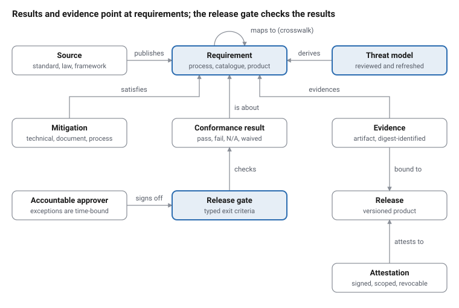

# Secure Development Lifecycle

As of 3 October 2026. Every fact was checked against the library records of topic `sdl`; see the bibliography.

## Executive summary

A secure development lifecycle (SDL) makes security a property of how software is built, not a test bolted on at the end. The major frameworks broadly agree on a core: plan for security, define requirements, model threats, write and review code safely, test before release, protect the build and its dependencies, and fix what is found after release.

The field has moved from voluntary vendor practice to obligation. Microsoft made its SDL a mandatory internal policy in 2004. NIST's Secure Software Development Framework (SSDF, SP 800-218) became the US federal baseline after Executive Order 14028 (2021), and US agencies may ask suppliers to attest to it. The EU Cyber Resilience Act (Regulation 2024/2847) makes secure-by-design and vulnerability handling legal requirements for products sold in the EU from December 2027; its reporting duties have applied since September 2026.

For practitioners and students, five points matter most:

1. **Start with outcomes, not a framework.** The SSDF lists what a secure process must achieve. Microsoft SDL, SAFECode and IEC 62443-4-1 show how to organise the work. OWASP SAMM and BSIMM measure how mature it is.
2. **Threat modeling is one of the most widely shared practices.** Fifteen of the sixteen frameworks we crosswalked cover it under some name (eleven through published mappings), and it decides which other controls a product needs.
3. **Gates make an SDL real.** In our view, a practice only counts when a release decision depends on its evidence: a reviewed threat model, closed findings, a signed build.
4. **The supply chain is now part of the lifecycle.** SBOMs and dependency management are expected by most frameworks and required by the CRA. Build provenance (SLSA) is so far required by only a few.
5. **Evidence is the product.** Attestation forms, regulators and auditors ask for artifacts, not intentions. Design the process so its records come out as a by-product of the work.

This report compares the core specifications and walks the lifecycle phase by phase. It consolidates their requirements into one catalog and gives a staged plan for a student team, a small company or a larger organisation. It closes with the objects and relationships the specifications share, which is the basis for modeling an SDL as data.

## Origins and landscape

SDL practice began inside software vendors and has become public policy in two decades. Microsoft made its Security Development Lifecycle mandatory internally in 2004. The industry consortium SAFECode and the maturity models BSIMM (2008) and OWASP SAMM (2009) then generalised it beyond one company.

The policy turn came with US Executive Order 14028 (May 2021). It directed NIST to define secure development practices, which became the Secure Software Development Framework (SSDF), SP 800-218 v1.1, in February 2022. OMB memoranda M-22-18 and M-23-16 then required agencies to obtain SSDF attestations from their software suppliers, using a CISA form finalised in March 2024 (CISA now marks its page as archived). In January 2026, OMB memorandum M-26-05 rescinded both memos. Agencies may still request the attestation form and SBOMs, but they are no longer required to. The SSDF remains the federal reference, and its version 1.2 (SP 800-218r1) is still an initial public draft (December 2025).

Other governments moved from guidance toward law at the same time:

- **United States (CISA):** *Secure by Design* principles (April 2023, revised October 2023) and a voluntary Secure by Design Pledge (May 2024).
- **European Union:** the Cyber Resilience Act (Regulation 2024/2847) makes secure development and vulnerability handling legal duties. Reporting of actively exploited vulnerabilities applies from September 2026 and the full regulation from 11 December 2027. Its first harmonised standards (EN 40000 series) are still being approved, and none is yet cited in the Official Journal.
- **United Kingdom:** a Software Security Code of Practice (May 2025).
- **Germany:** BSI's technical guidelines TR-03183 (CRA requirements) and TR-03185 (secure software lifecycle).

| Date | Milestone | Effect on SDL practice |
| --- | --- | --- |
| Sep 2026 | CRA reporting obligations apply | Actively exploited vulnerabilities and severe incidents need an early warning within 24 hours to the coordinating CSIRT and ENISA, via ENISA's single reporting platform |
| Jan 2026 | OMB M-26-05 | Rescinds M-22-18 and M-23-16; attestation becomes optional for US agencies |
| Dec 2025 | NIST SP 800-218r1 (SSDF 1.2) draft | Adds continuous improvement (PO.6) and robust updates (PS.4) |
| Dec 2024 | EU Cyber Resilience Act in force | Secure development and vulnerability handling become law for the EU market |
| Jul 2024 | NIST SP 800-218A | SSDF profile for generative AI and foundation models |
| Mar 2024 | CISA Secure Software Development Attestation Form | Suppliers attest to SSDF-derived practices |
| Oct 2023 | CISA Secure by Design (revised) | Manufacturers own customer security outcomes |
| Feb 2022 | NIST SSDF v1.1 (SP 800-218) | Outcome-based baseline used across later policy |
| May 2021 | US Executive Order 14028 | Orders secure-development standards for federal software |
| 2008–2009 | BSIMM and OWASP SAMM | Maturity measurement for software security programmes |
| 2004 | Microsoft SDL mandatory | First large-scale SDL with phases and release gates |

## The core specifications compared

The SDL literature divides into four kinds of document, and most confusion comes from comparing documents of different kinds. Read them as layers. An outcome framework says *what* to achieve, and a process standard says *how* to organise it. A maturity model says *how well* you do it, and a verification standard says *what the product must satisfy*.

| Specification | Issuer, version | Kind | Structure | How conformance is shown |
| --- | --- | --- | --- | --- |
| Secure Software Development Framework (SP 800-218) | NIST, v1.1 Feb 2022; v1.2 draft Dec 2025 | Outcome framework | 4 groups (Prepare, Protect, Produce, Respond), 19 practices, 42 tasks | Self-attestation; optional in US federal procurement since 2026 |
| SSDF Community Profile for AI (SP 800-218A) | NIST, Jul 2024 | Outcome profile | SSDF tasks plus AI-specific recommendations, with priorities | Voluntary |
| Microsoft Security Development Lifecycle | Microsoft; current web practices; Process Guidance 5.2 (2012) | Process (vendor) | Current: 10 practices, 48 sub-practices. 5.2: Training → Requirements → Design → Implementation → Verification → Release → Response, with a Final Security Review | Internal gates in 5.2 (Final Security Review); none published in the current set; no external certification |
| Fundamental Practices for Secure Software Development | SAFECode, 3rd ed. Mar 2018 | Process (industry) | Design, coding, third-party components, testing, finding management, vulnerability response | None |
| IEC 62443-4-1 | IEC, Ed. 1.0 2018 | Process standard | 8 practices, 47 requirements, maturity levels 1–4 | Third-party certification (ISASecure SDLA) |
| IEC 81001-5-1 | IEC, Ed. 1.0 2021 (ISH1 2025) | Process standard, health software | Lifecycle activities derived from 62443-4-1 | FDA-recognised consensus standard; one framework FDA names for secure product development |
| ISO/IEC 27034-1 | ISO/IEC, 2011 | Process framework | Organisation Normative Framework, Application Normative Framework, application security controls | Audit against targeted level of trust |
| BSI TR-03185 | BSI (Germany), v1.1.1 2026 | Process guideline | Secure software lifecycle requirements by phase, drawn from the SSDF and IEC 62443-4-1; its open-source part is aligned with the CRA | Audit checklist |
| OWASP SAMM | OWASP, v2.2.0 Jul 2026 | Maturity model (prescriptive) | 5 business functions, 15 practices, 30 streams, 90 activities, levels 1–3 | Self-assessment score |
| BSIMM | Black Duck, BSIMM16 Feb 2026 | Maturity model (descriptive) | 4 domains, 12 practices, 128 activities observed in 111 firms | Benchmark assessment |
| OWASP ASVS | OWASP, 5.0.0 May 2025 | Verification standard | 345 requirements in 17 chapters, levels 1–3 | Test against requirements |
| SLSA | OpenSSF, v1.2 Nov 2025 | Supply-chain integrity levels | Build track L0–L3; Source track L1–4 | Provenance and verification summary attestations |
| OSPS Baseline | OpenSSF, 2026.08.28 | Open-source project baseline | 41 controls, levels 1–3 | Self-assessment, automatable |
| Cyber Resilience Act | EU, Regulation 2024/2847 | Law | Essential requirements (Annex I) plus manufacturer obligations | CE marking; harmonised standards pending |
| Software Security Code of Practice | UK DSIT/NCSC, May 2025 | Voluntary code | 14 principles in 4 themes | Self-assessment, assurance claims |

Three patterns stand out:

- **The SSDF is the hub.** Its References column maps its tasks to BSIMM, SAMM, IEC 62443-4-1, SAFECode and others. SAMM, OSPS, BSI, ETSI and BSIMM publish mappings back to it. A team that maps its process to the SSDF can answer most other frameworks by translation.
- **Gates are defined in different styles.** The SSDF says its table order implies no sequence, and the current Microsoft SDL publishes no gate. Release gates come from SDL 5.2's Final Security Review, IEC 62443-4-1, BSIMM's checkpoint activities, SSDF PO.4's criteria and, as a legal precondition, the CRA.
- **Maturity is measured differently.** SAMM prescribes what each level should contain, and its score sums credit across levels. BSIMM describes what firms actually do and counts observations. SAMM's quality criteria say what must be true, but it checks them by interview; neither model says what evidence proves an activity happened.

## The lifecycle, phase by phase

The frameworks use different names, but their practices fall onto one common phase line: governance, requirements, design, implementation, verification, release and response, with supply-chain controls running across all of them. The phases repeat on every release, and in agile teams on every increment.

### Governance and training

Security starts as an organisational commitment with named owners. SSDF PO.1–PO.2 call for documented security requirements for the organisation's development infrastructure and processes, and defined roles with training. The UK Code makes a Senior Responsible Owner accountable for assurance across its 14 principles. SAMM's Governance function and BSIMM's Strategy & Metrics practice add policy, metrics and a security champions network. The CRA (Article 13) requires a documented cybersecurity risk assessment, kept up to date over the product's support period.

### Requirements

Security requirements come from three sources: the organisation's policies, applicable law and contracts, and the product's own risks. SSDF PW.1.2 records risk responses as security requirements. IEC 62443-4-1 SR-1 to SR-5 require a defined product security context, security requirements and their review. A verification standard such as OWASP ASVS gives ready-made requirements by assurance level.

### Design and threat modeling

Threat modeling is covered, under some name, by 15 of the 16 frameworks in our crosswalk. It goes by many names: SSDF PW.1.1 (risk modeling), IEC 62443-4-1 SR-2 (threat model), Microsoft SDL's threat modeling practice, SAMM's Threat Assessment, BSIMM's Architecture Analysis, ISO/SAE 21434's TARA. Secure design principles (least privilege, defence in depth, secure defaults) and an independent design review follow from it. SSDF PW.2.1 asks for an independent review of the design against the requirements and identified risks; its examples add a review of the risk models.

BSI TR-03185 requires the threat model in the design phase, reviewed and kept current. The Enduring Security Framework (ESF) developer guide adds governance rules for it: approval by at least two independent engineers, and a refresh at every functional change or major release, and at least yearly. SDL 5.2 recommended a work item for each vulnerability listed in the threat model.

### Implementation

Use approved tools and secure coding standards, reuse vetted components, and check code continuously. SSDF PW.4 covers acquiring and reusing well-secured components, and PW.5 covers secure coding. PW.7 covers code review and analysis, and PO.3 covers the toolchain. IEC 62443-4-1 SI-1 and SI-2 require implementation review and secure coding standards.

### Verification

Test the product against its security requirements and its threat model. Use static and dynamic analysis, fuzzing and penetration testing. SSDF PW.8 covers testing executable code, and IEC 62443-4-1 SVV-1 to SVV-5 cover requirements, threat-mitigation and vulnerability testing, penetration testing and tester independence. The FDA expects traceability from threat model to risk assessment to tests.

### Release — the gate

A release gate turns practices into decisions. SSDF PO.4 calls for criteria for security checks and the information needed to show they were met. SDL 5.2's Final Security Review had three outcomes: passed, passed with exceptions, or escalation. No release could pass with known vulnerabilities rated Critical, Important, Moderate or Low unless a security advisor granted an exception. BSIMM activities SM1.4 and SM1.7 describe setting and enforcing release conditions, and SM2.6 describes risk-owner sign-off. BSI TR-03185 allows release only when all security issues are "conclusively addressed". The CRA bars placing a product on the market with known exploitable vulnerabilities.

### Response

After release, monitor, triage, fix, disclose and learn. SSDF RV.1–RV.3 cover identifying, remediating and root-causing vulnerabilities, including feeding the cause back into the process. ISO/IEC 29147 (disclosure) and 30111 (handling) define the process. The CRA sets deadlines for actively exploited vulnerabilities and severe incidents: a 24-hour early warning, a 72-hour notification, then a final report (14 days after a fix for a vulnerability, one month after notification for an incident). It also requires free security updates over a support period of normally at least five years.

## Consolidated requirements catalog

These twenty requirements are the ones shared most widely across the frameworks. We built them by crosswalking 16 frameworks, with the SSDF's 42 tasks as the hub and other anchors where the SSDF is silent. We used published mappings first and our own reading where no publisher maps. The full crosswalk (34 requirements, about 1,030 clause references) is MAP-0001 in the tmodel repository. No single requirement appears in all 16 frameworks.

The "Published" column counts frameworks with at least one clause placed by a published mapping, whether by that framework's own authors or by another publisher such as NIST, OWASP SAMM or OpenSSF. "Any match" adds clauses we placed by reading both texts.

| # | Requirement | Phase | Published / any match (of 16) | Example clauses |
| --- | --- | --- | --- | --- |
| 1 | Manage third-party component risk: select, assess, update and monitor components; hold suppliers to your requirements | Implementation | 13 / 15 | SSDF PO.1.3, PW.4.1, PW.4.4; IEC 62443-4-1 SM-9; CRA Annex I Part II(1) |
| 2 | Security-test executable code before release (functional, dynamic, fuzzing, known-vulnerability scans) | Verification | 12 / 15 | SSDF PW.8.1, PW.8.2; IEC SVV-1; CRA Annex I Part II(3) |
| 3 | Threat-model the product during design, keep the model current, and disposition every threat | Design | 11 / 15 | SSDF PW.1.1; IEC SR-2; ISO/SAE 21434 Clause 15; CRA Annex I Part I(1) |
| 4 | Apply secure design principles and reuse vetted security features | Design | 11 / 14 | SSDF PW.1.3; IEC SD-2; CRA Annex I Part I(2)(d) |
| 5 | Record, rate, prioritise and remediate each vulnerability within defined times | Response | 11 / 14 | SSDF RV.2.1, RV.2.2; IEC DM-2; CRA Annex I Part II(2) |
| 6 | Monitor released software for new vulnerabilities and investigate every credible report | Response | 11 / 14 | SSDF RV.1.1, RV.1.2; IEC DM-1; CRA Annex I Part II(6) |
| 7 | Ship a secure default configuration and hardening guidance | Release | 11 / 13 | SSDF PW.9.1, PW.9.2; IEC SG-3; CRA Annex I Part I(2)(b) |
| 8 | Produce and maintain an SBOM for each release | Release | 10 / 13 | SSDF PS.3.2; IEC SM-9; CRA Annex I Part II(1) |
| 9 | Use an approved, securely configured toolchain | Implementation | 10 / 12 | SSDF PO.3.1, PO.3.2, PW.6.1; IEC SI-2 |
| 10 | Publish a coordinated vulnerability disclosure policy and contact | Response | 10 / 12 | SSDF RV.1.3; IEC DM-1; CRA Annex I Part II(5) |
| 11 | Define and track security requirements with their risks and design decisions | Requirements | 9 / 14 | SSDF PO.1.1, PO.1.2, PW.1.2; IEC SR-3 |
| 12 | Review and statically analyse code; triage findings | Implementation | 9 / 14 | SSDF PW.7.1, PW.7.2; IEC SI-1 |
| 13 | Follow a documented secure coding standard | Implementation | 9 / 13 | SSDF PW.5.1; IEC SI-2 |
| 14 | Protect development environments and source code | Implementation | 9 / 13 | SSDF PO.5.1, PO.5.2, PS.1.1; IEC SM-7 |
| 15 | Sign or hash every release and archive release data | Release | 9 / 12 | SSDF PS.2.1, PS.3.1; IEC SM-6 |
| 16 | Check defined security criteria at a release gate, with accountable sign-off | Release | 8 / 12 | SSDF PO.4.1, PO.4.2; IEC SM-11, SM-12; CRA Annex I Part I(2)(a) |
| 17 | Review the security of the design against requirements and threat model | Design | 8 / 11 | SSDF PW.2.1; IEC SD-3 |
| 18 | Penetration-test the product, preferably independently | Verification | 8 / 11 | SSDF PW.8.2; IEC SVV-4 |
| 19 | Train everyone in the lifecycle in role-based secure development | Governance | 8 / 10 | SSDF PO.2.2; IEC SM-4 |
| 20 | Keep secrets and credentials out of code; ship without default secrets | Implementation | 7 / 14 | OSPS BR-07.01, BR-07.02; SSDF PO.5.2 |

The weakest areas are as telling as the strongest. Build provenance has published mappings in only 3 frameworks, and notification of actively exploited vulnerabilities in 1 (the CRA). Cryptographic standards and AI-specific practices are treated unevenly. These are the places where frameworks still disagree, and where an implementer must choose.

Two cautions apply. Published mappings are often informative, not claims of equivalence, and some contradict each other: the SSDF and OWASP SAMM disagree on 10 IEC and 40 BSIMM mappings, SAMM's own two SSDF mappings disagree on 15 tasks, and ETSI TS 104 219 prints ten component-provenance (SBOM) rows under threat modeling. Some clauses legitimately serve two rows: CRA Annex I Part II(1) covers both component identification and the SBOM. And for ISO/SAE 21434 and the FDA guidance no publisher maps at all, so every cell in those columns is our judgement and awaits expert review.

## Software supply chain security

Modern software is largely assembled from third-party components, so an SDL that covers only first-party code misses much of what ships. Most current frameworks now treat dependencies as part of the lifecycle, and a growing number also cover the build system and the release channel.

The requirements fall into four groups:

1. **Know what you ship.** Keep an inventory of components and publish a software bill of materials (SBOM). SSDF PS.3.2 asks for provenance data for every component of every release. The EU Cyber Resilience Act (Annex I, Part II) requires manufacturers to draw up an SBOM covering at least top-level dependencies, kept in the technical documentation. CISA's 2026 *Minimum Elements for an SBOM* updates the 2021 NTIA baseline.
2. **Prove how it was built.** SLSA v1.2 defines a Build track with levels L0–L3. At L2 a hosted build platform's control plane, not the build itself, generates provenance. At L3 builds run isolated, and the key that signs provenance is unreachable from user-defined build steps. A new Source track (L1–L4) covers how revisions are protected and reviewed, up to two-person review of protected branches.
3. **Verify before you deploy.** NIST SP 800-204D describes signed attestations about the build environment, the process, the materials and the resulting artifacts. A signed policy is evaluated against those attestations before deployment. SLSA's Verification Summary Attestation (VSA) records the verifier, the policy, the inputs and a pass or fail result.
4. **Handle vulnerabilities after release.** Monitor components, triage, fix and disclose. VEX (Vulnerability Exploitability eXchange) statements say when a known vulnerability does not affect the product; OpenSSF's OSPS Baseline requires one at level 3 (VM-04.02). The CRA adds legal clocks for actively exploited vulnerabilities: a 24-hour early warning, a 72-hour notification and a final report within 14 days of a fix being available.

The open-source ecosystem has its own baseline. The OpenSSF *Open Source Project Security Baseline* (release 2026.08.28) has 41 controls in three levels, cumulative with two noted exceptions. At level 3 it requires "threat modeling and attack surface analysis" (OSPS-SA-03.02). OpenSSF Scorecard checks repositories automatically against 20 heuristics. It records whether releases are signed but, in its own words, "does not verify the signatures".

A practical rule follows: **signatures and SBOMs are evidence, not assurance.** An SBOM says what its author believes is inside an artifact. Provenance says how a trusted builder produced it. Only verification against a policy turns either into a release decision.

## Implementing an SDL

Adopt an SDL in stages, and make each stage produce evidence before adding the next. The frameworks are large; none expects day-one completeness. SAMM describes maturity as something earned activity by activity, and BSIMM shows which activities peer organisations actually perform.

### Stage 1 — Foundations (weeks)

- Name an owner. The UK Code of Practice assigns a Senior Responsible Owner; SSDF PO.2 asks for defined roles and responsibilities.
- Write a one-page secure-development policy: the practices you follow, the tools you use, and who approves a release.
- Turn on what platforms give for free: branch protection, required review, secret scanning, dependency alerts, and automated static analysis in CI.
- Publish a vulnerability disclosure policy, even a `security.txt` file and a monitored mailbox.

### Stage 2 — Design-time security (one release cycle)

- Threat-model every new feature and every architecture change. Record each threat, its disposition (mitigate, accept, transfer, avoid) and the mitigation.
- Turn mitigations into security requirements and test cases (SSDF PW.1.2).
- Adopt a verification standard as the definition of "secure enough" — for web applications, OWASP ASVS level 1 or 2.
- Define the release gate: no open critical findings, threat model reviewed, dependencies scanned.

### Stage 3 — Build and supply-chain integrity

- Build on a hosted, scripted platform and generate signed provenance (SLSA Build L2, then L3).
- Produce an SBOM for every release and keep it with the artifact.
- Verify signatures and provenance before deployment, against a written policy.

### Stage 4 — Measure and improve

- Run a SAMM self-assessment once a year and pick two or three practices to raise by one level.
- Feed root causes back: when a vulnerability escapes, ask which practice failed (SSDF RV.3) and fix the process, not only the code.
- Track a small set of metrics: time to fix by severity, share of releases with a reviewed threat model, share of dependencies with known vulnerabilities.

### Scaling the plan

| Setting | Minimum credible SDL | Evidence to keep |
| --- | --- | --- |
| Student team project | Stages 1–2: policy, threat model per feature, code review, SAST and dependency scanning in CI, a release checklist | Threat model file in the repo, CI logs, review history, release checklist |
| Small company or open-source project | Stages 1–3; OSPS Baseline level 1–2 for open source; SBOM per release | SBOM, signed provenance, disclosure policy, advisories |
| Regulated or enterprise product | All four stages; map to SSDF and to sector rules (CRA, IEC 62443-4-1, FDA guidance, IEC 81001-5-1) | Attestations, assessment results, gate approvals, vulnerability reports within legal deadlines |

### Common pitfalls

- **Tools without gates.** Scanners whose results never block a release produce noise, not security.
- **Threat models that never change.** ESF guidance asks for a refresh on every functional change, every major release and at least yearly.
- **Evidence written after the fact.** Retrofitted documents fail audits and miss real risks. Generate records from the work itself.
- **Signatures nobody verifies.** Signing helps only where a consumer or a deployment gate checks it.
- **Framework tourism.** Pick one outcome framework (usually SSDF) and one maturity model (usually SAMM), and map everything else to them.

## Measuring maturity

Maturity models tell you where to invest next. They do not certify that a product is secure. Use one to set targets, and use gate evidence and vulnerability outcomes to check that the targets mean something.

**OWASP SAMM (v2.2.0)** is prescriptive and free. Each of 15 security practices has two streams, and each stream has activities at three maturity levels, with quality criteria for every activity. A self-assessment answers questions per activity. In the official toolbox a practice's score adds up credit across levels: a team can earn level-2 credit while level 1 is incomplete. So read a SAMM score as a weighted profile, not a staircase. SAMM publishes official, explicitly informative mappings to the SSDF, BSIMM (edition 14), IEC 62443-4-1, NIST CSF 2.0 and the Microsoft SDL.

**BSIMM (BSIMM16)** is descriptive. It records which of 128 activities a sample of 111 firms actually perform, grouped into 12 practices across 4 domains, and reports how common each activity is. Its value is benchmarking: "what do organisations like ours do?" Activity labels change when an activity moves level between editions, so mappings must name the edition.

**IEC 62443-4-1** defines maturity levels 1 to 4, from ad hoc to continuously improving, and has the best-known independent certification scheme for the development process (ISASecure SDLA). PCI's Secure SLC Standard also runs an assessor programme.

**Metrics that matter.** Across the frameworks, the measures that connect process to outcome are few:

| Metric | What it shows | Source of the idea |
| --- | --- | --- |
| Releases passing the security gate without exceptions | Whether the gate is real | SSDF PO.4, SDL 5.2 FSR |
| Threats with an approved, evidenced disposition | Whether design risks are closed | SSDF PW.1.2, IEC 62443-4-1 SR-2/SVV-2 |
| Time to remediate by severity | Response capacity | SSDF RV.2, CRA Annex I Part II |
| Escaped vulnerabilities traced to a failed practice | Whether the process learns | SSDF RV.3 |
| Share of releases with SBOM and signed provenance | Supply-chain coverage | SSDF PS.3, SLSA |

A warning applies to all of them: neither SAMM nor BSIMM defines what evidence proves an activity happened. That has to be designed into the process (see the object model below).

## SDL concepts as an object model

Read together, the references fit one data model, although no single reference states it, so an SDL can be run as data rather than as documents. We read each reference once with a single question: what objects and relationships does it assume? The 42 object models extracted this way define 1,510 objects and 1,230 relationships. Merging equivalent concepts maps 1,146 of those objects onto 46 shared object types and 925 relationships onto 60 relationship types, each traced back to its source and locator. The rest belong to the threat, product and supply-chain models covered elsewhere.

**The shape.** A *source* (a standard, law or framework) publishes *requirements* in three tiers:

1. what the development process must do (an SSDF task);
2. what a catalogue says software must have (an ASVS requirement, a CRA essential requirement);
3. what one product's own security requirements say.

A product meets requirements through *mitigations*. Each is a technical feature, a document or a process step. *Evidence*, bound to a specific release, shows the mitigation exists. An *assessment* records a result per requirement. A *gate*, usually the release gate, checks typed exit criteria and is signed off by an accountable person; *exceptions* are time-bound. Producers issue signed *attestations*, and reports such as a threat model or an SDL plan are *governed views*: generated from the data, with an owner, approvers, a version and an audience.

**The threat model sits at the centre.** Twenty of the 42 references call for a threat model, its review, or its refresh when the product changes. Ten call for a broader security risk assessment, six of them alongside a threat model; we keep the two separate. It is where requirements come from (risks become security requirements) and what release gates check (every in-scope threat has an approved, evidenced disposition).

*Core SDL object model: 10 of the 46 object types and 10 of the 60 relationships.*

Read it from the release gate: the gate checks conformance results against typed exit criteria, such as every in-scope threat being dispositioned. Each result is about one requirement, and the evidence behind it is bound to a specific release.

Sixteen of the 46 types, chosen for the SDL core:

| Object | What it is | References that use it (of 42) |
| --- | --- | --- |
| Requirement | A citable obligation, at process, catalogue or product tier | 33 |
| Evidence | A version-bound artifact proving a mitigation or practice | 29 |
| Mitigation (kind: technical, documentation, process) | What satisfies a requirement or treats a threat | 28 |
| Attestation | A signed, scoped, revocable claim (self-attestation, certificate, VSA, declaration of conformity) | 21 |
| Threat model | The design-time analysis of how the product could be attacked, reviewed and refreshed | 20 |
| Governed document view | A generated, approved, versioned report | 20 |
| Vulnerability handling policy | The published way to report flaws and the process for handling them | 20 |
| Gate criterion | A typed exit condition: bug bar, level, threats mitigated, policy over attestations | 18 |
| SDL programme | The organisation's lifecycle, its roles and its policy | 17 |
| Conformance result | Outcome of assessing one requirement, with reason and version pin | 17 |
| Exception | A time-bound, approved deviation from a requirement | 15 |
| Gate | An ordered, dated decision point with approver and outcome | 14 |
| Crosswalk mapping | A typed, edition-pinned link between requirements of different sources | 11 |
| Security risk assessment | The broader risk analysis that scopes and consumes the threat model | 10 |
| Assurance level | A cumulative product target (SLSA, ASVS, OSPS levels) | 9 |
| Maturity level | A rating of the development organisation (SAMM, IEC 62443-4-1 ML) | 5 |

Five findings matter for anyone building SDL tooling:

- **Mitigations come in three kinds.** BSI TR-03183-1 types controls as mechanism, documentation or activity, which maps one-to-one to technical, documentation and process; BSI offers the types "for easier differentiation" and accepts any kind of control.
- **A level is not a gate.** A level says how strongly something holds (SLSA L3, ASVS L2); a gate says when a decision is made. A maturity level (SAMM, IEC 62443-4-1) rates the organisation, not the product. BSIMM's levels describe how common an activity is and should never be used as a pass mark.
- **Results need more than pass and fail.** Sources use not applicable (with a reason), inconclusive, partial, covered by a remediation plan, and waived. Keep the native value; do not collapse it.
- **Everything has a time axis.** Support periods, exception expiry, threat-model refresh triggers, evidence freshness and attestation lapse all need validity dates. Requirements themselves can be rescinded, as OMB M-26-05 showed.
- **Crosswalks must be typed and dated.** A mapping says whether one requirement implements, supports or equals another, and which edition it targets. Many published mappings are explicitly informative and must not be read as equivalence.

## Bibliography

Every entry below was opened and checked against its official source between 2 and 3 October 2026. Each one has a record in the Threat-Radar library (topic `sdl`); most carry a content hash, extracted requirements and an object model. The exceptions are summary-only or stub records: CIS/SAFECode, PCI Secure SLC, EO 14144 and EO 14306. Paywalled standards are marked; for those, only free material was used (publisher previews, and for IEC 62443-4-1 the public ISASecure SDLA-312 requirement text).

### Outcome frameworks and US federal policy

- NIST. [SP 800-218, *Secure Software Development Framework (SSDF) Version 1.1*](https://nvlpubs.nist.gov/nistpubs/SpecialPublications/NIST.SP.800-218.pdf). February 2022.
- NIST. [SP 800-218r1, *SSDF Version 1.2* (Initial Public Draft)](https://nvlpubs.nist.gov/nistpubs/SpecialPublications/NIST.SP.800-218r1.ipd.pdf). 17 December 2025.
- NIST. [SP 800-218A, *Secure Software Development Practices for Generative AI and Dual-Use Foundation Models: An SSDF Community Profile*](https://nvlpubs.nist.gov/nistpubs/SpecialPublications/NIST.SP.800-218A.pdf). July 2024.
- NIST. [SP 800-204D, *Strategies for the Integration of Software Supply Chain Security in DevSecOps CI/CD Pipelines*](https://nvlpubs.nist.gov/nistpubs/SpecialPublications/NIST.SP.800-204D.pdf). February 2024.
- NIST. [SP 800-53 Rev. 5, *Security and Privacy Controls for Information Systems and Organizations*](https://nvlpubs.nist.gov/nistpubs/SpecialPublications/NIST.SP.800-53r5.pdf), SA and SR families. Rev. 5 upd1 PDF (December 2020); Release 5.2.0 (27 August 2025) published as OSCAL.
- Executive Office of the President. [Executive Order 14028, *Improving the Nation's Cybersecurity*](https://www.govinfo.gov/content/pkg/FR-2021-05-17/pdf/2021-10460.pdf). 12 May 2021.
- Executive Office of the President. [Executive Order 14144, *Strengthening and Promoting Innovation in the Nation's Cybersecurity*](https://www.govinfo.gov/content/pkg/FR-2025-01-17/pdf/2025-01470.pdf). 16 January 2025.
- Executive Office of the President. [Executive Order 14306, *Sustaining Select Efforts to Strengthen the Nation's Cybersecurity](https://www.govinfo.gov/content/pkg/FR-2025-06-11/pdf/2025-10804.pdf) and Amending Executive Order 13694 and Executive Order 14144*. 6 June 2025.
- OMB. [M-22-18, *Enhancing the Security of the Software Supply Chain through Secure Software Development Practices*](https://bidenwhitehouse.archives.gov/wp-content/uploads/2022/09/M-22-18.pdf). 14 September 2022. Rescinded by M-26-05.
- OMB. [M-23-16, *Update to Memorandum M-22-18](https://bidenwhitehouse.archives.gov/wp-content/uploads/2023/06/M-23-16-Update-to-M-22-18-Enhancing-Software-Security.pdf), Enhancing the Security of the Software Supply Chain through Secure Software Development Practices*. 9 June 2023. Rescinded by M-26-05.
- OMB. [M-26-05, *Adopting a Risk-based Approach to Software and Hardware Security*](https://www.whitehouse.gov/wp-content/uploads/2026/01/M-26-05-Adopting-a-Risk-based-Approach-to-Software-and-Hardware-Security.pdf). 23 January 2026.
- CISA. [*Secure Software Development Attestation Form*](https://www.cisa.gov/sites/default/files/2024-04/Self_Attestation_Common_Form_FINAL_508c.pdf), OMB control no. 1670-0052. 11 March 2024.
- CISA et al. [*Shifting the Balance of Cybersecurity Risk: Principles and Approaches for Secure by Design Software*](https://www.cisa.gov/sites/default/files/2023-10/SecureByDesign_1025_508c.pdf). Revised 25 October 2023.
- CISA. [*Secure by Design Pledge*](https://www.cisa.gov/sites/default/files/2024-05/CISA%20Secure%20by%20Design%20Pledge_508c.pdf). May 2024.
- CISA and FBI. [*Secure by Demand Guide](https://www.cisa.gov/sites/default/files/2024-08/SecureByDemandGuide_080624_508c.pdf): How Software Customers Can Drive a Secure Technology Ecosystem*. August 2024.
- CISA et al. [*Secure by Demand: Priority Considerations for Operational Technology Owners and Operators*](https://www.cisa.gov/sites/default/files/2025-01/joint-guide-secure-by-demand-priority-considerations-for-ot-owners-and-operators-508c_0.pdf). January 2025.
- NSA, CISA and ODNI (Enduring Security Framework). [*Securing the Software Supply Chain: Recommended Practices Guide for Developers*](https://media.defense.gov/2022/Sep/01/2003068942/-1/-1/0/ESF_SECURING_THE_SOFTWARE_SUPPLY_CHAIN_DEVELOPERS.PDF). August 2022.
- FDA. [*Cybersecurity in Medical Devices: Quality Management System Considerations and Content of Premarket Submissions*](https://www.fda.gov/media/119933/download). Final guidance, 3 February 2026.

### Process standards and vendor lifecycles

- Microsoft. [*Security Development Lifecycle practices*](https://www.microsoft.com/en-us/securityengineering/sdl/practices). Web practice set, retrieved October 2026.
- Microsoft. [*Security Development Lifecycle Process Guidance, Version 5.2*](https://download.microsoft.com/download/3/4/3/343bafcb-c685-4a70-9639-ff76bcbb609c/Microsoft%20SDL_Version%205.2.docx). 23 May 2012. CC BY-NC-SA 3.0.
- Microsoft. [*Simplified Implementation of the Microsoft SDL*](https://download.microsoft.com/download/f/7/d/f7d6b14f-0149-4fe8-a00f-0b9858404d85/Simplified%20Implementation%20of%20the%20SDL.doc). 4 November 2010.
- SAFECode. [*Fundamental Practices for Secure Software Development*, 3rd edition](https://safecode.org/wp-content/uploads/2018/03/SAFECode_Fundamental_Practices_for_Secure_Software_Development_March_2018.pdf). March 2018.
- IEC. [IEC 62443-4-1:2018, *Secure product development lifecycle requirements*](https://webstore.iec.ch/en/publication/33615). Edition 1.0. Paywalled.
- IEC/ISO. [IEC 81001-5-1:2021, *Health software and health IT systems — Security — Activities in the product life cycle*](https://webstore.iec.ch/en/publication/63293). Corrected version 2025-12 including ISH1. Paywalled.
- ISO/IEC. [ISO/IEC 27034-1:2011, *Application security — Overview and concepts*](https://www.iso.org/standard/44378.html). Paywalled.
- ISO/SAE. [ISO/SAE 21434:2021, *Road vehicles — Cybersecurity engineering*](https://www.iso.org/standard/70918.html). Paywalled.
- BSI. [TR-03185, *Secure Software Lifecycle*](https://www.bsi.bund.de/SharedDocs/Downloads/EN/BSI/Publications/TechGuidelines/TR03185/BSI-TR-03185.pdf?__blob=publicationFile&v=5), v1.1.1. July 2026.
- ETSI. [TS 104 219, *Software Security Development and Implementation Framework (SSDIF)*](https://www.etsi.org/deliver/etsi_ts/104200_104299/104219/01.01.01_60/ts_104219v010101p.pdf), V1.1.1. March 2026.
- PCI SSC. [*Secure Software Lifecycle (Secure SLC) Standard v2.0*](https://blog.pcisecuritystandards.org/pci-ssc-releases-version-2.0-of-the-secure-software-lifecycle-standard). 28 September 2026. Announcement only; the standard is licence-gated and was not read.

### Law and national codes

- European Union. [Regulation (EU) 2024/2847, *Cyber Resilience Act*](https://eur-lex.europa.eu/legal-content/EN/TXT/PDF/?uri=CELEX:32024R2847). OJ L, 20 November 2024, as corrected.
- BSI. [TR-03183-1, *Cyber Resilience Requirements for Manufacturers and Products, Part 1*](https://www.bsi.bund.de/SharedDocs/Downloads/EN/BSI/Publications/TechGuidelines/TR03183/BSI-TR-03183-1_v1_0_0.pdf?__blob=publicationFile&v=3), v1.0.0. July 2026.
- ENISA. [*Secure by Design and Default Playbook*](https://www.enisa.europa.eu/sites/default/files/2026-07/ENISA_Secure_By_Design_and_Default_Playbook_v1.pdf), v1.0. July 2026. CC BY 4.0.
- UK DSIT and NCSC. [*Software Security Code of Practice*](https://assets.publishing.service.gov.uk/media/69a8060a2e1f4fbda4252270/Software_Security_Code_of_Practice_Web_Accessible.pdf). 7 May 2025.

### Maturity models

- OWASP. [*Software Assurance Maturity Model (SAMM)* v2.2.0](https://owaspsamm.org/model/). July 2026. CC BY-SA 4.0.
- Black Duck. [*BSIMM16*](https://www.blackduck.com/content/dam/black-duck/en-us/reports/bsimm-report.pdf). February 2026 (report PDF dated January 2026). CC BY-SA 3.0.
- OWASP. [*DevSecOps Maturity Model (DSOMM)* 5.1.0](https://dsomm.owasp.org/). September 2026.
- CIS and SAFECode. [*Secure by Design v1.1: A Guide to Assessing Software Security Practices*](https://www.cisecurity.org/insights/white-papers/secure-by-design-v1-1-a-guide-to-assessing-software-security-practices). July 2026.

### Verification, supply chain and vulnerability handling

- OWASP. [*Application Security Verification Standard (ASVS) 5.0.0*](https://github.com/OWASP/ASVS/releases/tag/v5.0.0_release). May 2025.
- OpenSSF. [*SLSA Specification v1.2*](https://slsa.dev/spec/v1.2/). November 2025.
- OpenSSF. [*Open Source Project Security Baseline* v2026.08.28](https://baseline.openssf.org/). August 2026.
- OpenSSF. [*Scorecard* checks, v5.5.0](https://github.com/ossf/scorecard/blob/v5.5.0/docs/checks.md). April 2026.
- OpenSSF. [*Concise Guide for Developing More Secure Software*](https://best.openssf.org/Concise-Guide-for-Developing-More-Secure-Software). Living document.
- CNCF TAG Security. [*Software Supply Chain Best Practices v2*](https://github.com/cncf/tag-security/tree/main/community/working-groups/supply-chain-security/supply-chain-security-paper-v2). March 2025.
- ISO/IEC. [ISO/IEC 29147:2018, *Vulnerability disclosure*](https://www.iso.org/standard/72311.html). Paywalled.
- ISO/IEC. [ISO/IEC 30111:2019, *Vulnerability handling processes*](https://www.iso.org/standard/69725.html). Paywalled.
